<div align="center">

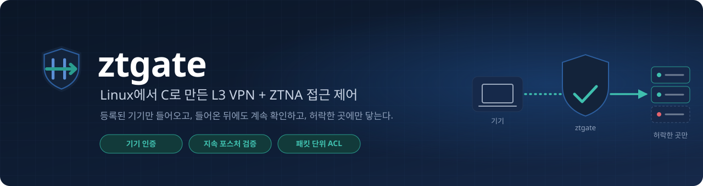

[](https://github.com/k1msatgat/ztgate/actions/workflows/ci.yml)


[한눈에 보기](#한눈에-보기) · [화면](#화면) · [시작하기](#시작하기) · [배포와 운영](#배포와-운영) · [동작 흐름](#등록부터-차단과-복구까지의-동작-흐름) · [서버 구조](#서버-구조) · [프로토콜](#프로토콜) · [보안 모델](#보안-모델) · [표준 프로토콜과의 대조](#표준-프로토콜과의-대조) · [알려진 제약](#알려진-제약) · [Windows 클라이언트](#windows-클라이언트) · [빌드와 의존성](#빌드와-의존성)

</div>

---

**ztgate**는 Linux 서버와 Linux 클라이언트 사이에 L3 터널을 만들고, 그 터널을 지나는 모든 패킷에 "이 기기가 지금 여기에 닿아도 되는가"를 묻는 VPN입니다.
WireGuard나 IPsec이 하는 일(터널, 키 합의, 암호화)과 Tailscale·NetBird 같은 ZTNA 제품이 그 위에 얹는 일(기기 등록, 단말 상태 확인, 정책)을 외부 VPN 라이브러리 없이 C로 처음부터 짰습니다.

- **인증과 암호화.** 기기마다 다른 키로 챌린지-응답 인증을 하고, 핸드셰이크마다 일회용 ECDH P-256 키와 기기 키를 HKDF로 섞어 방향별 AES-256-GCM 세션 키를 만듭니다.
- **패킷마다 판정.** 세션 패킷은 64개 폭의 재전송 창을 지나 ACL(첫 일치, 기본 거부)을 통과한 뒤에만 tun에 쓰입니다.
- **지속 검증.** 클라이언트가 10초마다 다시 보고하는 포스처(OS 버전, 방화벽)가 정책에 못 미치면 세션 중에도 끊깁니다.
- **서버가 정하는 설정.** 터널 주소와 경로는 클라이언트가 아니라 서버가 정해서 내려 줍니다.
- **사용자 확인.** 그 장비를 **누가** 쓰는지는 회사 IdP(OIDC)에서 받은 토큰으로 확인합니다. 서버는 JWT의 서명을 IdP의 공개키로 검증하고, ACL 규칙에 `user=` 나 `group=`을 적어 그 사람에게만 엽니다.
- **구현.** 서버는 epoll 이벤트 루프로 TUN과 UDP 소켓을 함께 처리합니다. 기본은 단일 스레드이고, `-w N` 이면 워커 N 개가 나눠 처리합니다.

| | 전통적인 VPN | 이 프로젝트 |
|---|---|---|
| 누가 들어오는가 | 비밀번호나 인증서를 가진 사람 | **등록된 기기 + 로그인한 사용자**. 기기는 자기 키로 서버의 물음에 답하고, 사용자는 IdP가 서명한 토큰을 낸다 |
| 한 번 들어오면 | 세션이 끝날 때까지 믿는다 | **10초마다 다시 본다.** 방화벽을 끄면 세션 중에도 끊긴다 |
| 어디까지 가는가 | 내부망 전체 | **적어서 연 곳만.** 규칙이 없으면 터널 대역 밖으로 나가지 못한다 |
| 설정은 누가 갖는가 | 클라이언트의 설정 파일 | **서버.** 터널 주소와 경로를 서버가 내려 주고, 정책을 고치면 붙어 있는 기기가 따라온다 |

> **상태: v0.9 개발 중 (프로토콜 v9), [변경 기록](CHANGELOG.md).** v7 에서 터널 설정에 내부 DNS 가, v8 에서 공개키 기기 신원이, v9 에서 핸드셰이크의 기기 ID / 포스처 감싸기가 더해져 이전 버전과는 통하지 않습니다. 0.6.0에서 이름을 my_vpn에서 ztgate로 바꿨습니다. Linux 서버, Linux 클라이언트, 앱 커넥터, Windows 클라이언트(서비스 + GUI)가 있습니다. CI가 푸시마다 서버 프로토콜 시험 356개, 전체 경로 시험 67개, 웹 콘솔 시험 48개, 운영 CLI 시험 16개, Keycloak 연동 시험(DPoP 포함)을 돌리고, 서버 패키지(DEB / RPM)와 Windows MSI 를 만듭니다. 암호 프로토콜은 아직 독립적인 보안 검토를 받지 않았습니다. 운영 환경에 두기 전에 [보안 모델](#보안-모델)과 [알려진 제약](#알려진-제약)을 먼저 읽어 주세요.

서버를 운영한다면 [ztgate 서버 운영하기](docs/guide/admin.md)와 [운영 참고](docs/guide/admin-reference.md)를, Windows 에서 접속한다면 [사용자 안내서](docs/guide/user.md)를 먼저 읽습니다. 이 README 는 구조, 프로토콜, 모든 옵션을 다룹니다.

## 한눈에 보기

<p align="center">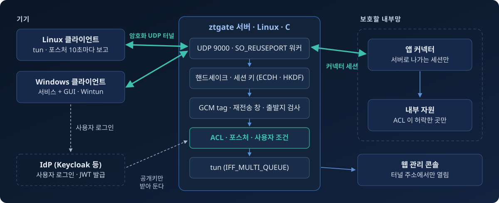</p>

- **기기**는 서버로 암호화된 UDP 터널을 열고, 서버가 허락한 곳으로만 패킷을 보냅니다.
- **서버**는 기기와 사용자를 확인하고 패킷마다 ACL로 판정합니다. IdP와는 통신하지 않고, 관리자가 받아 둔 공개키로 토큰만 확인합니다.
- **커넥터**는 내부망 안에서 서버로 "나가는" 세션을 열어, 내부망에 들어오는 포트 없이 자원을 내어 줍니다.

| 조각 | 어디서 도는가 | 하는 일 |
|---|---|---|
| **`vpn_server`** | Linux. 패키지로 설치하면 `ztgate` 계정 | 기기를 인증하고, 세션마다 키를 합의하고, 패킷마다 ACL에 대 본 뒤 tun에 쓴다. epoll 단일 스레드 (`-w N` 이면 워커 N 개) |
| **`vpn_client`** | Linux, root | 등록 코드로 기기를 올리고, 인증 핸드셰이크 뒤에 tun을 만들어 서버가 준 주소·MTU·경로를 넣는다. 10초마다 포스처(커널 버전, nftables 방화벽)를 다시 보고한다. 토큰 파일(`-t`)이 바뀌면 세션 안으로 보낸다 |
| **`vpn_client connector`** | Linux, 내부망 안 | 앱 커넥터. 서버로 나가는 세션을 열고, 서버가 보내 준 내부망 행 패킷을 LAN으로 내보낸다 (NAT, 답만 들인다). 내부망에 들어오는 포트를 열지 않는다 |
| **`ztgate_login`** | Linux, 일반 사용자 | IdP에 OAuth 기기 인가(RFC 8628)로 로그인해 토큰을 파일에 쓰고, 끝나기 전에 갈아 끼운다. 비밀번호는 브라우저에서 IdP에만 넣는다 |
| **MCP 서버 / `ztgate_ctl`** | Linux | 관리자(또는 AI 에이전트)가 서버를 올리고 내리고, 등록 코드를 만들고, 정책을 바꾸고, 감사 로그를 본다 |
| **`tools/loadgen`** | Linux | 서버 데이터 경로의 부하 생성기. 클라이언트와 같은 프로토콜 코드를 쓴다 |
| Windows 클라이언트 | Windows | 같은 프로토콜을 따로 구현한 서비스와 GUI. [아래](#windows-클라이언트) |

## 화면

<table>
<tr>
<td colspan="2">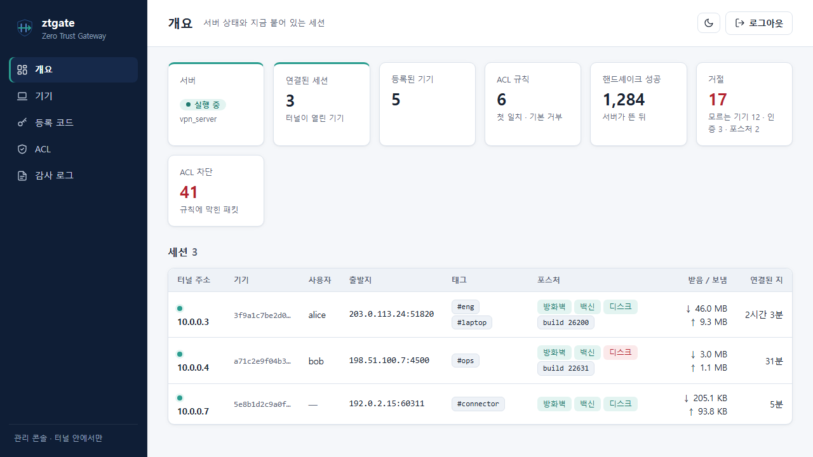</td>
</tr>
<tr>
<td width="50%">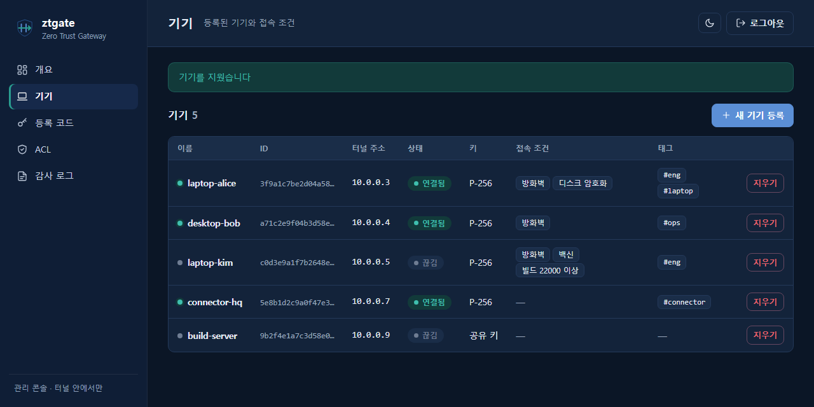</td>
<td width="50%">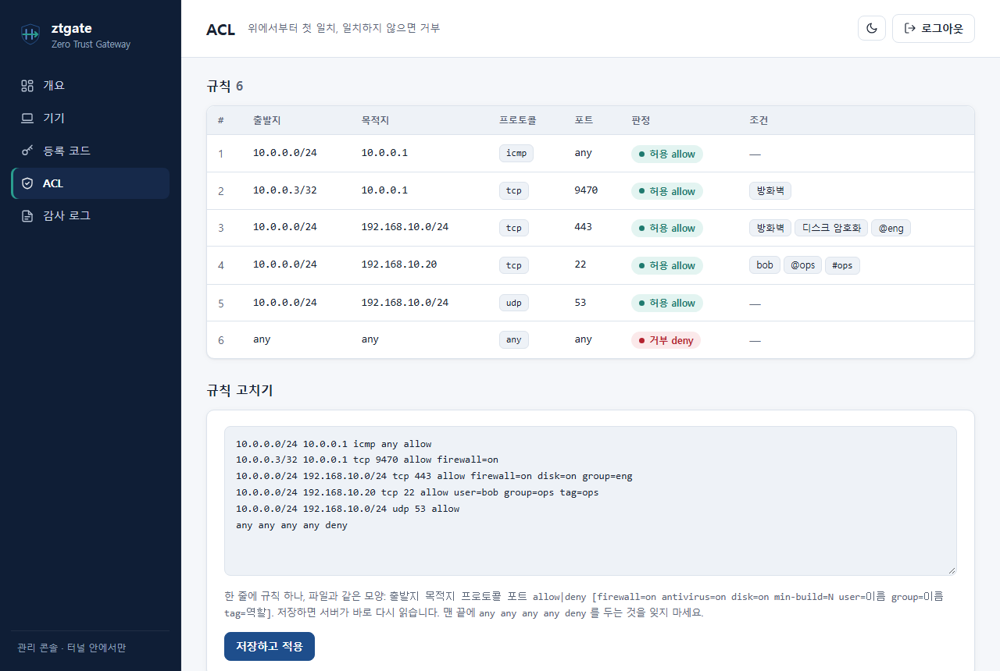</td>
</tr>
<tr>
<td width="62%">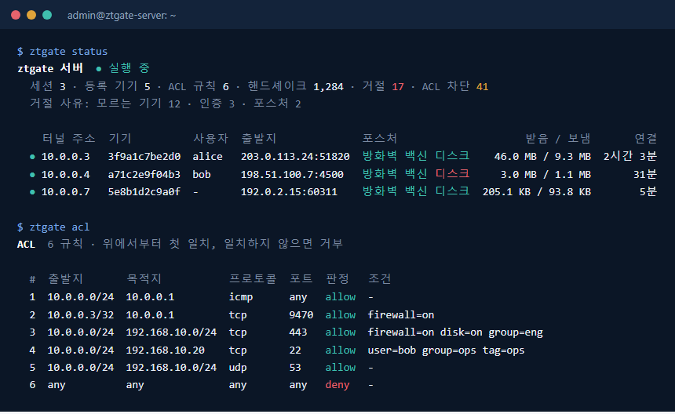</td>
<td width="38%" align="center">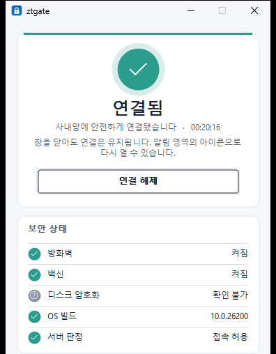</td>
</tr>
</table>

- **웹 관리 콘솔.** 세션, 기기, 등록 코드, ACL, 감사 로그. 밝은 화면과 어두운 화면 ([배포와 운영](#웹-관리-콘솔)). 위 그림은 데모 데이터다.
- **`ztgate` 명령.** 서버에서 같은 정보를 표와 색으로 (`ztgate status`, `devices`, `enroll`, `acl`, `audit`).
- **Windows 클라이언트.** 상태 판의 색 띠와 원이 연결 상태를 보여 주고, 보안 상태를 항목별로 보여 준다.
- 색과 글꼴은 [디자인 토큰](docs/design/tokens.md) 하나를 모든 화면이 함께 쓴다.

## 시작하기

### 한 장비에서 전체 흐름 보기

가장 빠른 방법은 테스트 스크립트입니다. 네트워크 네임스페이스 두 개에 서버와 클라이언트를 띄우고 veth로 이어서, 등록부터 포스처 거부와 복구까지 한 번에 돌립니다. root가 아니면 사용자 네임스페이스(`unshare -rn`) 안에서 돌기 때문에 장비의 네트워크는 건드리지 않습니다.

```bash
make                  # gcc, make, OpenSSL 3 개발 헤더 (openssl-devel / libssl-dev), nftables
test/linux_e2e.sh
```

```
== 2. connect
ok   connect: tun has the address the server assigned
ok   connect: route from the ACL allow rule (198.51.100.0/24)
ok   connect: ping 10.0.0.1 through the tunnel
== 4. posture
ok   posture: policy tightened -> denied at the next keepalive
     (denied after 10s)
ok   posture: firewall on -> client re-handshakes by itself
     (reconnected after 1s)
all passed
```

Docker가 있다면 `docker/demo.sh`가 같은 시나리오를 서버와 클라이언트 두 컨테이너로 돌립니다. 둘 다 CI에서 푸시마다 돕니다.

### 장비 두 대로 띄우기

아래는 Rocky Linux 9 서버와 Ubuntu(WSL2 포함) 클라이언트 기준입니다.

**1. 서버를 빌드하고 포트를 엽니다.**

```bash
sudo dnf install -y gcc make openssl-devel nftables
make server
sudo firewall-cmd --permanent --add-port=9000/udp && sudo firewall-cmd --reload
```

클라우드 서버라면 콘솔의 보안 그룹에서도 UDP 9000을 열어야 합니다.

**2. 설정 파일을 만들고 서버를 띄웁니다.**

기기 목록과 등록 대기 목록은 비어 있어도 됩니다. 기기는 등록 코드로 올라오고, 그때 서버가 기기 목록에 직접 한 줄을 적습니다. 키가 들어가는 파일이라 권한이 `600`이 아니면 서버가 읽지 않습니다.

```bash
touch devices.conf enroll.conf && chmod 600 devices.conf enroll.conf
cat > acl.conf <<'ACL'
10.0.0.0/24  10.0.0.1  icmp  any  allow
any          any       any   any  deny
ACL
chmod 600 acl.conf
./server/bin/vpn_server genkey server.key      # 서버 키, 처음 한 번 (공개키를 찍는다)

sudo ./server/bin/vpn_server -e enroll.conf -k server.key -a audit.log 9000 devices.conf acl.conf
```

서버는 tun 장치를 만들고 이름(`tun device: tun0`)을 찍습니다. 다른 터미널에서 그 장치에 서버의 터널 주소를 붙입니다.

```bash
sudo ip addr add 10.0.0.1/24 dev tun0 && sudo ip link set tun0 mtu 1400 up
```

**3. 등록 코드를 만듭니다.**

코드는 그 기기가 받을 터널 주소와 포스처 조건을 정해서 만들고, 한 번만 쓸 수 있고 15분 뒤 만료됩니다. 스크립트가 대기 목록에 한 줄을 쓰고 서버에 `SIGHUP`을 보냅니다.

```bash
sudo env ENROLL_FILE=./enroll.conf docker/enroll-code.sh 10.0.0.2 -l laptop
# 7K2QF-9XWM4-ABCDE-FGHJK-MNPQR
```

Windows 기기에는 코드 대신 **초대 링크**를 보낼 수 있습니다. `server.env` 에 `PUBLIC_ADDRESS=vpn.example.com` 을 적어 두면 `ztgate_ctl` 의 `enroll_create`(MCP, 웹 콘솔)가 `ztgate://enroll?server=vpn.example.com&port=9000&code=…` 를 함께 돌려줍니다. 받은 사람이 링크를 누르면 GUI 가 서버와 코드가 채워진 등록 창을 엽니다 (MSI 가 `ztgate:` 를 GUI 에 묶습니다). 등록 창에 붙여 넣거나 `vpn_client.exe enroll <링크>` 로도 됩니다. 링크에는 코드가 들어 있으니 코드처럼 그 사람에게만 보냅니다. 관리 정책이 서버를 정해 둔 PC 는 링크의 서버를 따르지 않고 코드만 씁니다.

**4. 클라이언트를 등록하고 연결합니다.**

```bash
sudo apt install -y build-essential libssl-dev nftables
make client
sudo ./client/bin/vpn_client enroll <서버 IP> 9000 7K2QF-9XWM4-ABCDE-FGHJK-MNPQR
sudo ./client/bin/vpn_client run <서버 IP> 9000
```

`enroll`은 기기의 ID와 키를 새로 만들어 코드로 연 암호화된 세션 안에서 서버에 올리고, 서버가 받아 준 뒤에 `/var/lib/ztgate/device`(0600)에 저장합니다. 그때 받은 서버 공개키도 같이 적어 두고, 다음부터는 그 공개키를 내미는 서버에만 답합니다. `run`은 서버가 받아 준 뒤에야 tun을 만들고, 서버가 준 주소, MTU, 경로를 넣습니다. 클라이언트에 적는 것은 서버 주소뿐입니다.

```
[HS] posture: kernel=331264 firewall=off antivirus=unknown disk=off
[HS] established idx=b892bf00
[cfg] address 10.0.0.2/24
[cfg] mtu 1400
[ztgate0] connected
```

**5. 터널을 확인합니다.**

```bash
ping 10.0.0.1
```

이 두 장비 절차는 아직 실제 장비에서 처음부터 끝까지 따라 해 보지 않았습니다. 한 장비 재현(`linux_e2e.sh`)만 CI에서 확인합니다.

<details>
<summary><b>설정 파일과 포스처 조건</b></summary>

<br/>

```
# devices.conf: id (32 hex)  key (p256:<공개키> 또는 64 hex 공유 키)  tunnel-ip  [포스처 조건] [tag=역할]
2bd5d6e0610d2b7c07f884d0c5afb043   a24d4c3d…   10.0.0.2   firewall=on min-build=331264 tag=eng

# acl.conf: 위에서부터 첫 일치, 일치하는 규칙이 없으면 거부
# src          dst              proto  dport  action  [포스처 조건] [tag=역할]
10.0.0.0/24    10.101.0.0/16    tcp    443    allow
10.0.0.0/24    10.101.0.7       tcp    22     allow   firewall=on tag=eng
any            any              any    any    deny
```

- **태그(`tag=`)는 기기의 역할입니다.** 규칙에 태그를 적으면 그 태그 중 하나를 가진 기기의 규칙이 됩니다. 출발지 주소와 같은 자리라, 태그가 맞지 않는 기기에게는 그 규칙이 없는 것이고 다음 규칙을 봅니다 (조건에 못 미쳐 거부되는 포스처·사용자 조건과 다릅니다). 터널 주소를 하나씩 적지 않고 "엔지니어 노트북"처럼 묶게 됩니다. 영문 소문자, 숫자, `_` `-` 의 32자까지, 기기 하나와 규칙 하나에 넷까지. 등록 코드에 적은 태그는 등록된 기기에 그대로 옮겨집니다. 경로도 그 기기의 태그로 뽑습니다.
- 한 줄은 510자까지입니다. 더 긴 줄은 잘라 읽지 않고 그 파일을 거부합니다.

| 조건 | Windows 클라이언트 | Linux 클라이언트 |
|---|---|---|
| `firewall=on` | Windows 방화벽이 켜져 있다 | nftables에 input 훅의 `policy drop` 체인이 있거나 firewalld가 돈다 |
| `antivirus=on` | 보안 센터가 백신을 정상으로 본다 | 수집하지 않는다 (늘 거절된다) |
| `disk=on` | 시스템 드라이브의 BitLocker 보호가 켜져 있다 (암호화돼 있어도 보호가 일시 중지면 꺼짐) | `/` 가 dm-crypt(LUKS) 위에 있다 (LVM 과 겹쳐도 따라 내려가 찾는다) |
| `min-build=N` | OS 빌드가 N 이상 | 커널 버전 코드(`major<<16 \| minor<<8 \| patch`, 5.14.0 → 331264)가 N 이상 |

- 못 읽은 항목은 통과로 치지 않습니다. `vpn_client posture`로 보고할 값을 미리 볼 수 있습니다. Windows 의 BitLocker 는 서비스(SYSTEM)가 WMI 로 읽습니다. 관리자가 아닌 콘솔과 GUI 는 탐색기의 셸 속성으로 읽어 "모름"이 나올 수 있지만, 서버에 보고하는 것은 서비스의 값입니다. 디스크 칸은 0.9 에서 비어 있던 자리에 더한 것이라 이전 클라이언트는 "모름"을 보냅니다. 그래서 `disk=on` 을 걸면 그 기기들은 거절됩니다. WSL2처럼 nft 대신 iptables-legacy를 쓰는 환경에서는 방화벽이 "모름"으로 나올 수 있습니다.
- 두 파일 모두 `kill -HUP`으로 세션을 끊지 않고 다시 읽습니다. 파일이 깨져 있으면 이전 것을 그대로 씁니다. ACL을 쓸지는 서버를 시작할 때 정해집니다.
- `allow` 규칙의 목적지는 그 기기에 경로로도 내려갑니다.

| 서버 옵션 | 뜻 |
|---|---|
| `<port> <device-file> [acl-file]` | 듣는 포트, 기기 목록(필수), ACL(없으면 터널 대역 안까지만) |
| `-e <file>` | 등록 코드의 대기 목록 |
| `-a <file>` | 감사 로그 (사건마다 JSON 한 줄) |
| `-s <path>` | 읽기 전용 상태 소켓 (세션, 포스처, 사유별 거절 수) |
| `-n <prefix>` `-m <mtu>` | 터널 대역의 prefix 길이와 MTU (기본 24, 1400). 클라이언트에 그대로 내려간다 |
| `-u <file>` | 사용자 로그인을 받는다. IdP 설정 (아래 "사용자 로그인") |
| `-k <file>` | 서버 키 (`vpn_server genkey <file>` 로 한 번 만든다). 공개키 기기(`p256:`)와 등록 코드(`-e`)에 필요하다 |
| `-d <file>` | 내부 DNS (아래 "내부 DNS") |
| `-L <초>` | 세션 키의 수명 (기본 3600) |
| `-v` | 통과한 패킷마다 로그 한 줄 (시험과 진단용) |
| `-w <N>` | 워커 N 개 (기본 1). 아래 "성능" |
| `-r <N>` | 한 주소에서 받는 `AUTH` 를 초당 N 개로 (기본 20, 한꺼번에 세 배까지, 0 이면 끈다). 넘친 것은 열어 보지 않고 버리고 `auth_rate_limited` 로 센다. 한 NAT 뒤의 기기가 한꺼번에 다시 붙는 곳이면 늘린다 |
| `-F` | 상태 추적: 클라이언트로 가는 패킷은 그 클라이언트가 연 흐름의 답만 |
| `-t <port>` | TCP 로도 받는다 (예: 443). UDP 가 막힌 네트워크의 클라이언트가 `vpn_client -T <port>` 로 붙는다. 같은 패킷에 길이(2바이트)만 붙인다. TCP 위에 TCP 를 실으면 손실 때 느려지므로 UDP 가 되는 곳에서는 UDP 를 쓴다. Windows 클라이언트는 UDP 핸드셰이크에 답이 없으면 **같은 번호의 TCP 포트**로 스스로 바꿔 본다. Windows 를 받으려면 `-t` 에 UDP 와 같은 포트를 준다 |

</details>

<details>
<summary><b>사용자 로그인 (IdP 연동)</b></summary>

<br/>

기기 인증은 "등록된 그 장비인가"까지만 말합니다. 그 장비를 누가 쓰는지는 회사의 IdP가 압니다. 사용자는 IdP에 로그인해 토큰(JWT)을 받고, 클라이언트는 그 토큰을 열린 세션 안에서 서버에 보냅니다. 서버는 토큰의 서명을 IdP의 공개키로 확인하고 사용자와 그룹을 세션에 붙입니다. 로그인하지 않아도 세션은 열리고, `user=` 나 `group=`이 걸린 규칙만 맞지 않습니다.

```
# acl.conf: 사용자 조건은 포스처 조건과 같은 자리에. 여럿이면 그중 하나면 된다
10.0.0.0/24    10.101.0.7       tcp    22     allow   group=sre firewall=on
10.0.0.0/24    10.101.0.20      tcp    5432   allow   user=alice user=bob
10.0.0.0/24    10.101.0.0/16    tcp    443    allow
any            any              any    any    deny
```

**서버.** IdP의 공개키 묶음(JWKS)을 파일로 받아 두고 `-u`로 설정을 줍니다. 서버는 IdP와 직접 통신하지 않습니다. 단일 스레드 이벤트 루프가 HTTPS 응답을 기다리는 동안 모든 터널이 멈추기 때문입니다. IdP가 키를 바꾸면 파일을 갈아 끼우고 `SIGHUP`을 보냅니다. 이 일은 `tools/idp/ztgate_jwks.py` 가 서버 밖에서 합니다. 이 도구는 설정 문서에서 `jwks_uri` 를 찾아 받고, 서명 키가 있는 온전한 묶음이고 지금 것과 다를 때만 갈아 끼운 뒤 다시 읽게 합니다. `ztgate-jwks.timer` 가 15분마다 돌립니다.

```bash
curl -s https://idp.example.com/realms/corp/protocol/openid-connect/certs | sudo tee /etc/ztgate/jwks.json > /dev/null   # 서비스로 설치했으면 ztgate-jwks.timer 가 대신 받는다
cat > /etc/ztgate/idp.conf <<'EOF'
issuer        https://idp.example.com/realms/corp    # 토큰의 iss 와 정확히 같아야 한다
audience      ztgate                                 # 토큰의 aud 에 들어 있어야 한다
jwks          jwks.json                              # 상대 경로는 이 파일 기준
user-claim    preferred_username                     # 기본 sub
groups-claim  groups                                 # 기본 groups
EOF
./server/bin/vpn_server verify-token /etc/ztgate/idp.conf < token.txt    # 서버를 띄우기 전에 토큰 하나를 대 본다 (패키지는 /opt/ztgate/server/bin/vpn_server)
# ok user=alice groups=ops expires_in=299s
```

**클라이언트.** `ztgate_login`이 기기 인가로 로그인해 토큰을 파일에 쓰고, `vpn_client -t`가 그 파일을 지켜보다 바뀌면 보냅니다. 비밀번호와 MFA는 브라우저에서 IdP에만 넣습니다.

```bash
client/ztgate_login --issuer https://idp.example.com/realms/corp --client-id ztgate --keep
#   Open this address in a browser and sign in:
#       https://idp.example.com/realms/corp/device?user_code=WDJB-MJHT
sudo ./client/bin/vpn_client -t ~/.config/ztgate/token run <서버 IP> 9000
#   [login] logged in as alice (token valid for 299s)
```

**Windows.** GUI 의 [설정] 에 로그인 주소(발급자)와 클라이언트 ID 를 넣으면 주 창의 연결 정보 판에 사용자 줄과 [로그인] 이 생깁니다. 누르면 기본 브라우저로 IdP 의 로그인 화면이 열리고, 로그인하면 브라우저가 `http://127.0.0.1:<빈 포트>/callback` 으로 돌아와 GUI 가 토큰을 받습니다. 데스크톱 앱의 표준 방식(RFC 8252, 인가 코드 + PKCE S256)입니다. 비밀번호와 MFA 는 브라우저에서 IdP 에만 들어가고, 이미 회사 SSO 에 로그인된 브라우저면 바로 끝납니다.

- 토큰은 GUI 가 받아 서비스에 건네고, 서비스가 세션 안으로 서버에 보냅니다. 서비스(SYSTEM, PC 에 하나)는 사람의 자격을 들고 있지 않습니다. **토큰은 그것을 건넨 GUI 가 붙어 있는 동안만 쓰입니다.** GUI 를 끝내거나 로그오프하면 서비스가 버리고, 사용자 없는 새 세션을 엽니다. 사용자 전환이나 원격 연결이 끊길 때도 뺐다가 돌아오면 다시 건넵니다.
- 토큰 수명의 4분의 3 이 지나면 refresh token 으로 브라우저 없이 갱신합니다. refresh token 은 그 Windows 사용자의 DPAPI 로, IdP 주소와 클라이언트 ID 에 묶어 감싸 둡니다. 다음에 켤 때 브라우저 없이 이어서 로그인합니다.
- [로그아웃] 은 서버의 세션에서 사용자를 떼고, 저장한 refresh token 을 지우고, IdP 에 폐기를 요청합니다(RFC 7009, `revocation_endpoint` 가 있을 때). IdP 의 브라우저 세션은 그대로라 다음 로그인은 비밀번호 없이 끝날 수 있습니다.
- 갱신이 끝내 안 되면(IdP 에 닿지 않음, refresh token 이 끝남) 사용자 줄과 Windows 알림으로 알립니다. 서버가 새 토큰도 만료라고 하면 PC 와 서버의 시계가 어긋난 것이라, 갱신을 거듭하지 않고 멈춰서 알립니다.
- IdP 에 따라 refresh token 을 받으려면 scope 에 `offline_access` 를, 서버용 access token 을 받으려면 그 API 의 scope 를 더해야 합니다. [설정] 의 범위(scope) 칸입니다 (기본 `openid`).

**토큰을 기기에 묶기 (DPoP, RFC 9449).** 기기가 서명 키를 가지고, IdP 에 토큰을 청할 때 그 키로 만든 증명을 붙이면 IdP 는 그 키의 지문(`cnf.jkt`)을 적은 토큰을 줍니다. 클라이언트는 LOGIN 마다 같은 키로 새 증명(그 토큰의 해시, 시각, 한 번만 쓰는 값)을 토큰 뒤에 붙이고, 서버는 서명과 지문, 해시, 시각(앞뒤 2분), 재사용을 봅니다. 토큰 파일이 새어도 그 기기의 키 없이는 쓰이지 않습니다.

```bash
client/ztgate_login --issuer ... --client-id ztgate --dpop-key /var/lib/ztgate/dpop.pem --keep
sudo ./client/bin/vpn_client -D /var/lib/ztgate/dpop.pem -t ~/.config/ztgate/token run <서버 IP> 9000
```

- Windows 는 따로 할 것이 없습니다. 키는 서비스가 가지며(PC 의 키, TPM 이 있으면 TPM 안에, 내보낼 수 없음) LOGIN 증명도 서비스가 만들고, GUI 가 IdP 에 토큰을 청할 때는 서비스에 증명을 받아 DPoP 헤더로 싣습니다.
- 서버의 `idp.conf` 에 `dpop required` 를 두면 묶이지 않은 토큰은 받지 않습니다 (기본은 `optional` 입니다. 묶인 토큰은 증명을 보고, 묶이지 않은 토큰도 받습니다).
- IdP 가 DPoP 를 해야 합니다. Keycloak 26.0 은 `--features=dpop` 로 켜고(CI 가 이렇게 띄워 묶인 토큰과 서버의 판정을 확인합니다), IdP 가 DPoP 를 모르면 헤더를 무시하고 묶이지 않은 토큰을 줍니다.

**IdP (Keycloak 기준).** `test/keycloak_check.sh`가 CI에서 관리 API로 그대로 만드는 설정입니다.

1. 클라이언트 `ztgate`: 공개 클라이언트(client secret 없음. 사용자의 장비에는 비밀을 둘 수 없다), *OAuth 2.0 Device Authorization Grant* 켜기. Windows GUI 를 쓰면 *Standard flow* 도 켜고, 유효한 redirect URI 에 `http://127.0.0.1/*` 를 넣는다. GUI 는 PKCE(S256)를 늘 보낸다. Windows 만 쓰는 곳이면 *Advanced → Proof Key for Code Exchange* 를 `S256` 으로 걸어 PKCE 없는 요청을 막아도 되지만, Keycloak 은 그 설정을 기기 인가에도 적용해 PKCE 를 보내지 않는 `ztgate_login` 이 막힌다 (Linux 도 쓰면 걸지 않거나, 클라이언트를 둘로 나눈다). 포트는 GUI 가 실행 때마다 빈 것을 고르는데(RFC 8252 7.3), Keycloak 은 루프백 주소면 포트를 가리지 않고 받아 준다 (26.0.7 에서 CI 가 포트 둘로 확인). 다른 IdP 는 그 IdP 의 문서에서 루프백 redirect 를 확인한다.
2. 그 클라이언트의 매퍼 두 개: *Audience*(`ztgate`를 access token의 `aud`에), *Group Membership*(클레임 이름 `groups`, full path 끄기).
3. 사용자를 그룹에 넣는다.

- 받는 서명은 RS256, ES256뿐입니다. `alg: none`과 HS256은 받지 않습니다 (HS256을 받으면 공개키를 HMAC 키로 쓴 위조 토큰이 통과합니다). `kid`로 키를 고르고 키의 종류가 `alg`와 맞아야 합니다.
- `iss`, `aud`, `exp`는 반드시 봅니다. 같은 IdP가 다른 앱에 준 토큰은 `aud`에서 걸립니다.
- 토큰이 만료되면 그 순간부터 사용자 규칙은 맞지 않고, 다음 keepalive에서 세션에서 떼어 감사 로그에 `logout`으로 남깁니다. 세션과 터널은 그대로입니다.
- 이름과 그룹에 쓸 수 있는 글자는 영문, 숫자, `. _ @ + - /`입니다. 감사 로그와 상태 소켓의 JSON에 그대로 들어가기 때문입니다.
- 토큰은 UDP 패킷 하나(약 1.9KB, `LOGIN_TOKEN_MAX`)에 들어가야 합니다. 그룹이나 역할이 아주 많은 사용자는 넘을 수 있으니 IdP 에서 이 클라이언트에 주는 클레임을 줄입니다 (그룹 매퍼만 두고, 역할 매퍼는 빼기). 넘으면 Windows GUI 가 "토큰이 너무 큽니다" 로 알립니다.

</details>

<details>
<summary><b>Docker로 띄우기</b></summary>

<br/>

서버와 Linux 클라이언트가 한 이미지에 들어 있고, 첫 인자로 고릅니다. 권한은 `CAP_NET_ADMIN`과 `/dev/net/tun`만 줍니다.

```bash
docker build -t ztgate .
docker run -d --name vpn --cap-add NET_ADMIN --device /dev/net/tun \
    -p 9000:9000/udp -v ztgate_etc:/etc/ztgate ztgate server
docker exec vpn enroll-code.sh 10.0.0.2 -l laptop
docker run -d --cap-add NET_ADMIN --device /dev/net/tun \
    -e SERVER=<서버 IP> -e ENROLL_CODE=<코드> -v ztgate_id:/var/lib/ztgate ztgate client
```

서버 tun에 주소를 붙이는 일은 `docker/entrypoint.sh`가 합니다. `/etc/ztgate/acl.conf`가 있으면 서버가 뜰 때 읽습니다. 클라이언트 컨테이너가 보고하는 방화벽 상태는 컨테이너 네트워크 네임스페이스의 nft 규칙셋이고, 커널 버전은 호스트의 것입니다. 서버 뒤의 네트워크로 내보내는 설정(NAT)은 컨테이너 예시에 넣지 않았습니다.

</details>

<details>
<summary><b>서버 뒤의 네트워크로 내보내기</b></summary>

<br/>

기기가 서버 뒤의 네트워크(예: `10.101.0.0/16`)에 닿으려면 ACL의 `allow` 규칙, IP 전달, 주소 변환(NAT)이 필요합니다. 서비스로 설치했다면 `/etc/ztgate/server.env`에 `FORWARD_OUT=eth0`을 적으면 서비스가 뜰 때 IP 전달과 NAT, "안에서 시작한 연결의 답만 들인다"는 nft 규칙을 자기 표(`table ip ztgate`)에 넣고 내려갈 때 뺍니다. 서버가 그 네트워크 안에 있지 않다면 아래의 커넥터를 씁니다.

</details>

<details>
<summary><b>내부 DNS 로 내부 자원을 이름으로 찾기</b></summary>

<br/>

내부 자원을 IP 가 아니라 이름(`intranet.corp.example`)으로 쓰려면 그 이름을 아는 DNS 에 물어야 합니다. 서버에 `dns.conf` 를 주면(`-d`, 서비스로 설치했다면 `/etc/ztgate/dns.conf` 가 있을 때) 터널 설정에 실어 모든 기기에 내려 줍니다.

```
# dns.conf: domain 에 적은 이름(과 그 아래 이름)만 server 로 묻는다
server 10.101.0.53
domain corp.example
```

- **적은 도메인만 내부 DNS 로 묻습니다 (분할 DNS).** 그 밖의 이름은 PC 가 원래 쓰던 DNS 로 갑니다. 그래서 회사와 무관한 질의가 회사로 가지 않고, 내부 DNS 가 죽어도 인터넷은 됩니다. Windows 는 NRPT(이름 해석 정책 표), Linux 는 systemd-resolved 의 인터페이스별 도메인(`resolvectl domain <tun> ~corp.example`)으로 겁니다.
- **그 DNS 서버에 닿을 규칙이 있어야 합니다.** ACL 에 `udp 53` 을 여는 `allow` 를 적으면 그 대역이 경로로도 내려갑니다.
- 서버는 `domain` 이 없으면 `server` 를 적어도 내려 주지 않습니다. 커넥터에는 내려 주지 않습니다.
- `SIGHUP` 으로 다시 읽고, 붙어 있는 기기는 다음 keepalive 응답에서 새 값을 받습니다. 틀린 파일이면 이전 것을 그대로 씁니다.
- Linux 클라이언트는 systemd-resolved 가 없는 장비에서는 DNS 를 걸지 않고 그렇다고 로그에 남깁니다.

</details>

<details>
<summary><b>앱 커넥터는 내부망에 들어오는 포트를 열지 않는다</b></summary>

<br/>

서버가 내부망으로 직접 내보내려면 서버가 그 네트워크 안에 있어야 하고, 서버는 인터넷에 UDP 포트를 연 장비입니다. 커넥터는 내부망 안에 두는 작은 클라이언트로, 다른 기기처럼 등록되고 서버로 **나가는** 세션을 엽니다. 서버는 인터넷 쪽에 두고, 내부망 방화벽에는 들어오는 규칙이 하나도 필요 없습니다.

```
클라이언트 --DATA--> 서버 (ACL · 포스처 · 사용자) --DATA--> 커넥터 -> tun -> NAT -> 내부 자원
클라이언트 <--DATA-- 서버 (출발지 · 목적지 확인) <--DATA-- 커넥터 <- tun <- 답 (이미 있는 연결만)
```

```bash
# 서버: 커넥터로 쓸 기기를 등록 코드로 올린다 (MCP 의 enroll_create 에 connector 를 주어도 같다)
sudo env ENROLL_FILE=./enroll.conf docker/enroll-code.sh 10.0.0.9 -l gw connector=10.101.0.0/16

# 내부망 안의 장비: 등록하고 커넥터로 띄운다. eth0 은 내부망 쪽 장치
sudo ./client/bin/vpn_client enroll <서버 IP> 9000 <코드>
sudo ./client/bin/vpn_client connector <서버 IP> 9000 eth0
#   [connector] forwarding 10.0.0.0/24 -> eth0 (masquerade), replies only on the way back
```

- **판정은 서버가 합니다.** 커넥터로 보내기 전에 ACL, 포스처, 사용자 조건을 모두 지납니다. 커넥터는 정책을 모르고 받은 것을 내보낼 뿐입니다. 클라이언트는 ACL에서 뽑은 경로를 그대로 받고, 커넥터에는 경로를 내려 주지 않습니다 (그 대역은 커넥터 쪽에서 바로 붙어 있는 네트워크입니다).
- **커넥터가 보내는 것은 좁게 봅니다.** 출발지는 커넥터가 맡은 대역 안이어야 하고, 목적지는 붙어 있는 클라이언트여야 합니다. 서버의 주소나 다른 커넥터로는 보낼 수 없습니다.
- **내부망 쪽에서 터널로 연결을 시작할 수 없습니다.** 커넥터 장비의 nftables 표(`table ip ztgate_connector`)가 "tun → LAN은 통과, LAN → tun은 이미 있는 연결의 답만"을 지키고, 커넥터가 끝나면 표를 통째로 지웁니다.
- **커넥터가 붙어 있지 않으면 그 대역으로 가는 패킷은 버립니다.** 서버의 tun으로 대신 보내지 않습니다. 같은 목적지가 커넥터의 상태에 따라 다른 길로 가면 정책을 읽을 수 없습니다.

</details>

## 배포와 운영

위의 "장비 두 대로 띄우기"는 손으로 띄우는 방법입니다. 서버를 계속 돌릴 장비에는 systemd 서비스로 설치합니다.

### 서비스로 설치하기

```bash
mcp/install.sh                 # 일반 계정으로 실행한다. 필요한 곳에서 sudo 를 스스로 부른다
sudo systemctl enable --now ztgate
```

설치 스크립트는 서버를 빌드해 `/opt/ztgate`에 root 소유로 복사하고, 처음 한 번만 `/etc/ztgate`에 설정을 만듭니다. 다시 실행하면 실행 파일만 바꾸고 설정과 기기 목록은 건드리지 않습니다. 관리 헬퍼 `ztgate_ctl`과 MCP 서버도 함께 설치하므로 Node.js(npm)가 필요합니다.

| 경로 | 내용 |
|---|---|
| `/etc/ztgate/server.env` | `PORT`, `TUN_IP`, `PREFIX`, `MTU`, `FORWARD_OUT`(서버 뒤로 내보낼 인터페이스, 기본 꺼짐), `SESSION_LIFETIME`(세션 키의 수명, 초, 기본 3600), `TCP_PORT`(TCP 로도 받기, `-t`), `WORKERS`(`-w`), `AUTH_RATE`(`-r`), `STATEFUL=1`(`-F`), `PUBLIC_ADDRESS`(기기가 밖에서 서버에 닿는 이름, 쉼표로 넷까지. 있으면 등록 코드와 함께 초대 링크가 나온다) / `PUBLIC_PORT`(밖의 포트가 `PORT` 와 다를 때) |
| `/etc/ztgate/devices.conf` | 기기 목록. 등록 코드로 온 기기를 서버가 직접 적는다 |
| `/etc/ztgate/enroll.conf` | 등록 코드의 대기 목록 |
| `/etc/ztgate/acl.conf` | 있으면 ACL이 켜진다 |
| `/etc/ztgate/idp.conf`, `jwks.json` | 있으면 사용자 로그인을 받는다 |
| `/etc/ztgate/dns.conf` | 있으면 내부 DNS 를 기기에 내려 준다 |
| `/etc/ztgate/server.key` | 서버 키. 설치할 때 한 번 만든다. 서버가 지키는 비밀은 이것 하나다. 바꾸면 등록 코드로 올라온 기기가 모두 다시 등록해야 한다 |
| `/var/log/ztgate/audit.log` | 감사 로그 (사건마다 JSON 한 줄) |
| `/run/ztgate/status.sock` | 상태 소켓 (`ztgate` 계정과 root 만) |

### 패키지로 설치하기 (DEB / RPM)

저장소를 빌드할 수 없는 장비에는 서버 패키지 `ztgate-server` 를 씁니다. CI 가 만들어 산출물(`ztgate-server-deb`, `ztgate-server-rpm`)로 올리고, 직접 만들려면 `make server` 뒤에 `packaging/build.sh deb` 또는 `packaging/build.sh rpm` 입니다 (`packaging/out/`).

```bash
sudo apt install ./ztgate-server_<버전>_amd64.deb        # Debian, Ubuntu (OpenSSL 3, Node.js 18 이상)
sudo dnf install ./ztgate-server-<버전>-1.x86_64.rpm     # Rocky, RHEL 9
sudo systemctl enable --now ztgate
```

배치는 설치 스크립트와 같고(`/opt/ztgate`, `/etc/ztgate`), 다른 점은 셋입니다. 유닛은 `/usr/lib/systemd/system` 에, `ztgate_ctl` 은 `/usr/sbin` 에 놓입니다. MCP 서버는 npm 의존성이 있어 들어 있지 않습니다. 필요하면 그 장비에서 `mcp/install.sh` 를 씁니다. `ztgate_ctl` 은 Node.js 가 있어야 돌아 권장 의존으로만 둡니다. 설정(`/etc/ztgate`)은 패키지의 파일이 아니라 설치할 때 처음 한 번 만들어집니다. 그래서 업그레이드해도 기기 목록과 서버 키가 그대로이고, 패키지를 지워도(`purge` 도) 남습니다. 업그레이드하면 돌고 있던 서버를 새 실행 파일로 다시 올리고, 붙어 있던 기기는 `DISCONNECT` 를 받고 바로 다시 붙습니다. CI 가 설치 → 시작 → 다시 설치(서버 키가 그대로인지) → 제거(설정이 남는지)를 Ubuntu 24.04 와 Rocky Linux 9 에서 확인합니다.

서버는 root 가 아닌 시스템 계정 `ztgate` 로 돌고, 받는 힘은 `CAP_NET_ADMIN`(tun)과 `CAP_NET_BIND_SERVICE`(낮은 TCP 포트)뿐입니다 ([0011](docs/decisions/0011-server-runs-as-ztgate.md)). tun 주소와 전달 규칙은 root 로 따로 붙이고, `ProtectSystem=strict`로 파일 시스템을 읽기 전용으로 만든 뒤 `/etc/ztgate`(ztgate 소유)와 로그 디렉터리만 쓰게 엽니다. 콘솔의 계정과 토큰은 서버가 쓰지 못하는 `/etc/ztgate-console`(root)에 있습니다. 설정이 틀려 서버가 스스로 1로 끝나면 다시 올리지 않고, 그 밖의 이유로 죽으면 2초 뒤에 다시 올립니다.

### 일상 운영

| 하려는 일 | 방법 |
|---|---|
| 기기 추가 | 웹 콘솔의 등록 코드 화면, 또는 `echo '{"cmd":"enroll_create","label":"laptop"}' \| sudo ztgate_ctl` 로 코드(와 초대 링크)를 만들어 건넨다. `docker/enroll-code.sh` 는 컨테이너와 손으로 띄운 서버용이다 |
| 정책 바꾸기 | `acl.conf`나 `devices.conf`를 고치고 `sudo systemctl reload ztgate`. 붙어 있는 기기는 다음 keepalive(10초 이내)부터 따른다 |
| 기기 폐기 | `devices.conf`에서 그 줄을 지우고 reload. 다음 keepalive에서 끊긴다 |
| IdP 키 교체 | `ztgate-jwks.timer` 가 15분마다 받아 바뀌었으면 reload 한다. 바로 받으려면 `sudo systemctl start ztgate-jwks`. 깨진 묶음은 깔지 않고, 서버도 깨진 파일이면 이전 키를 그대로 쓴다 |
| ACL 켜고 끄기 | `acl.conf`를 만들거나 지우고 restart. 켜고 끄는 것은 시작할 때만 정해진다 |
| 무슨 일이 있었나 | `sudo tail -f /var/log/ztgate/audit.log` (세션, 거절, 접근, 로그인, 정책 변경, 관리 작업). 패키지의 logrotate 가 주마다 돌려 12주를 남긴다 |
| 백업과 되살리기 | `sudo ztgate-backup` 이 `/etc/ztgate`(기기 목록, ACL, 서버 키, IdP, 콘솔 계정)를 `/var/backups/ztgate` 에 묶는다 (600, 최근 14개). 하루 한 번 돌리려면 `sudo systemctl enable --now ztgate-backup.timer`. 되살리기는 `sudo ztgate-backup restore <파일>` 이다. 압축 안의 경로를 먼저 검사하고, 지금 설정을 백업한 뒤 서버를 내렸다 올린다. 서버 키가 들어 있으니 다른 장비로 옮길 때는 암호화한다 |
| 지금 누가 붙어 있나 | `ztgate status` (세션, 포스처, 사용자, 사유별 거절 수). 기기 · 등록 코드 · ACL · 감사 로그는 `ztgate devices` / `enroll` / `acl` / `audit`. 스크립트에는 `--json` 이나 `echo '{"cmd":"status"}' \| sudo ztgate_ctl` |
| 서버 로그 | `journalctl -u ztgate` |
| 지표 (Prometheus) | `tools/metrics/ztgate_exporter.py` 가 상태 소켓을 `127.0.0.1:9469/metrics` 로 내준다 (`ztgate-exporter.service`). 세션 수, 사유별 거절 수, 주고받은 양. `--per-session` 이면 세션마다 (기기 ID, 터널 주소, 사용자가 라벨에 들어가므로 밖으로 열 때는 인증하는 프록시를 앞에 둔다) |

`ztgate` 는 `ztgate_ctl` 의 답을 칸을 맞춘 표와 색으로 보여 주는 읽기 전용 명령입니다 (터미널일 때만 색, `NO_COLOR` 존중, `test/cli_check.py`). `ztgate_ctl`은 표준 입력으로 JSON 명령 하나를 받는 root 헬퍼입니다(`status`, `start` / `stop` / `restart` / `reload`, `logs`, `audit`, `device_*`, `enroll_*`, `acl_get` / `acl_set`). MCP 서버는 이 헬퍼를 감싸 AI 에이전트가 SSH로 같은 일을 하게 합니다. 셸은 열어 주지 않고, sudoers는 `ztgate_ctl`을 인자 없이 부르는 것 하나만 허용합니다.

```bash
claude mcp add ztgate -- ssh -T <user>@<서버 IP> ztgate_mcp       # AI 클라이언트 쪽 (선택)
```

### 웹 관리 콘솔

브라우저로 ([화면](#화면)) 지금 붙어 있는 세션(기기, 사용자, 출발지, 포스처, 주고받은 양), 기기 목록과 편집과 지우기, 등록 코드 만들기와 거두기, ACL 보기와 고치기(파일과 같은 한 줄 문법), 감사 로그를 봅니다 (`tools/console/ztgate_console.py`, 표준 라이브러리만). 일은 모두 `ztgate_ctl` 이 하므로 검증, 파일 잠금, 서버 다시 읽기가 MCP 와 같습니다.

```bash
sudo systemctl enable --now ztgate-console          # 패키지에 들어 있다. 127.0.0.1:9470
sudo /opt/ztgate/tools/ztgate_console.py user add alice --role admin --totp   # 관리자 계정 (비밀번호를 묻는다)
sudo /opt/ztgate/tools/ztgate_console.py user add bob --role viewer           # 보기만 하는 계정
ssh -L 9470:127.0.0.1:9470 <서버>                    # 관리자 PC 에서. 브라우저로 http://127.0.0.1:9470/
```

관리자마다 계정을 둡니다 (`/etc/ztgate-console/console.users`, 600). 비밀번호는 scrypt 로만 남고, `--totp` 로 만든 계정은 인증 앱의 6자리 코드도 맞아야 들어옵니다. 역할은 `admin`(바꾸기)과 `viewer`(보기만)이고, 조회 전용 계정에는 바꾸는 단추가 보이지 않으며 요청도 `ztgate_ctl` 에 닿기 전에 거절됩니다. 바꾼 일은 감사 로그에 `{"event":"admin","actor":"console:alice",...}` 로 남습니다 (MCP 는 `mcp`, sudo 계정은 `via`). 계정이 하나도 없을 때만 처음 뜰 때 만든 토큰(`sudo cat /etc/ztgate-console/console.token`)으로 들어오고, 계정을 만들면 토큰 로그인은 닫힙니다.

기본은 127.0.0.1 에서만 듣습니다. 밖에 열려면 `--tls-cert` 와 `--tls-key` 로 TLS 를 켜고 `-l 0.0.0.0:9470` 입니다. 쿠키는 HttpOnly / SameSite=Strict (TLS 면 Secure), 바꾸는 요청은 세션마다의 CSRF 값이 맞아야 받고, 로그인 실패는 출발지 주소마다 1초에 한 번까지입니다. 화면은 다른 사이트의 프레임에 들어가지 않습니다. ACL 을 켜고 끄는 것(서버 재시작)은 하지 않습니다. `test/console_check.py` 가 가짜 `ztgate_ctl` 앞에서 48가지를 봅니다 (계정, 역할, TOTP, 행위자, 기기 편집 포함, CI).

### 서버 여러 대 (장애 조치)

서버를 두 대 이상 두고 클라이언트에 모두 적으면, 지금 서버가 답하지 않을 때 다음 서버로 넘어갑니다.

```bash
vpn_client run 203.0.113.10,203.0.113.11 9000        # Linux, 넷까지
vpn_client ztgate 203.0.113.10,203.0.113.11 9000     # Windows 콘솔. GUI 는 설정의 서버 칸에 쉼표로
```

- 처음에는 답하는 서버를 찾을 때까지 차례로 해 봅니다 (Windows 는 서버마다 UDP, 그다음 같은 번호의 TCP). 연결 중에 지금 서버가 30초 동안 조용하고 다시 핸드셰이크도 실패하면, 30초를 더 기다리지 않고 2초 뒤 다음 서버로 넘어갑니다. 거절은 답이라 넘어가지 않습니다.
- 서버들은 **같은 기기 목록, ACL, 서버 키**를 써야 합니다 (같은 서버 키라야 등록 때 고정한 서버 공개키로 어느 서버에나 붙습니다). `ztgate-sync` 가 맞춰 줍니다 (아래). 세션은 서버마다 따로라, 넘어가면 새 핸드셰이크로 새 세션을 엽니다. 넘어가는 동안의 패킷은 잃습니다.
- 서버 뒤로 내보내는 경로(`FORWARD_OUT`)와 터널 주소 대역이 서버마다 같아야 클라이언트가 같은 주소를 받습니다. 같은 기기가 두 서버에 동시에 붙지는 않습니다 (클라이언트는 한 번에 한 서버).
- **설정 맞추기 (`ztgate-sync`).** 한 대를 주 서버로 정하고, 설정은 거기서만 고칩니다. 주 서버의 `/etc/ztgate-sync/sync.conf`(root 만 여는 폴더) 에 부 서버를 적고 켜면, 기기 목록 · ACL · 로그인 설정 · DNS · 서버 키가 바뀔 때마다 부 서버들에 rsync 로 보내고 다시 읽게 합니다 (5분마다 한 번 더, 꺼져 있던 부 서버를 따라잡게). 서버 키가 바뀌었거나 ACL, 로그인, DNS 를 켜고 끈 때는 다시 읽기로 반영되지 않으므로 부 서버를 다시 띄웁니다. `server.env` 와 등록 코드는 보내지 않습니다. 기기는 주 서버에서 등록하므로 `PUBLIC_ADDRESS` 의 첫 이름이 주 서버여야 합니다. 부 서버에는 `.sync-primary` 표시가 생기고, 그 서버의 `ztgate_ctl` 은 설정을 고치는 명령을 거절합니다.

  ```bash
  # 주 서버. 부 서버의 동기화 계정에는 키를 등록하고 sudo 로 rsync 와 systemctl reload / restart ztgate 만 연다.
  # 설정과 키는 서버 계정이 쓸 수 있는 /etc/ztgate 가 아니라 root 만 여는 곳에 둔다 (도구는 남이 쓸 수 있는 sync.conf 를 읽지 않는다).
  sudo install -d -m 700 /etc/ztgate-sync
  printf 'PEERS="sync@10.0.0.11"\nSSH_KEY=/etc/ztgate-sync/sync.key\n' | sudo install -m 600 /dev/stdin /etc/ztgate-sync/sync.conf
  sudo ssh -i /etc/ztgate-sync/sync.key sync@10.0.0.11 true   # 부 서버의 호스트 키를 지문으로 확인해 받아 둔다
  sudo ztgate-sync                                         # 한 번 해 보고
  sudo systemctl enable --now ztgate-sync.path ztgate-sync.timer
  ```

  주 서버가 죽으면 부 서버는 마지막으로 받은 설정으로 계속 받습니다. 그동안 새 기기 등록과 설정 변경은 멈춥니다. 부 서버를 주 서버로 올리려면 그 서버의 `.sync-primary` 를 지우고 `sync.conf` 를 옮깁니다.
- 떠다니는 주소(VIP, keepalived 등) 하나를 두 서버가 넘겨받는 방식도 됩니다. 서버는 요청이 도착한 주소에서 답하므로(`IP_PKTINFO`) 두 번째 주소로 받은 요청에도 그 주소로 답합니다.

### 업그레이드

1. 저장소를 받고 `mcp/install.sh`를 다시 실행한 뒤 `sudo systemctl restart ztgate`. 패키지로 설치했으면 새 패키지를 설치하는 것으로 끝입니다 (서버를 스스로 다시 올립니다).
2. **서버를 먼저 올립니다** ([ADR 0012](docs/decisions/0012-version-compat.md)). 서버는 받지 않는 버전의 클라이언트에게 받는 범위를 `VERSION` 으로 알려 주고 `version_mismatch` 로 셉니다. Windows 는 "업데이트가 필요합니다"를 보여 주고 업데이트 확인을 바로 띄웁니다. Linux 클라이언트에는 응답이 없는 것처럼 보입니다.
3. 서버를 다시 시작하면 세션은 모두 사라집니다. 클라이언트는 서버에서 30초 동안 아무것도 받지 못하면 스스로 다시 핸드셰이크합니다.

### 문제 해결

| 증상 | 원인과 해결 |
|---|---|
| 클라이언트가 `[HS] no response from server` | UDP 포트가 막혔거나(호스트 방화벽, 클라우드 보안 그룹) 서버가 꺼져 있습니다. 서버 로그에 `[drop] protocol vN from a client` 가 찍히면 프로토콜 버전이 다릅니다 |
| `[HS] denied: unknown device` | 등록되지 않았거나 코드가 만료됐습니다. 감사 로그에서 `enrolled`를 찾습니다 |
| `[deny] posture does not meet policy` | 기기의 포스처가 정책에 못 미칩니다. 클라이언트에서 `vpn_client posture`로 보고할 값을 보고 `devices.conf`의 조건과 비교합니다 |
| 연결은 되는데 특정 목적지만 안 됨 | 그 목적지의 `allow` 규칙이 없거나 규칙의 조건(포스처, `user=`, `group=`)이 맞지 않습니다. 감사 로그의 `access` 줄에서 판정을 봅니다 |
| 로그인이 거절됨 | `vpn_server verify-token /etc/ztgate/idp.conf < token.txt`가 이유(서명, `iss`, `aud`, `exp`)를 알려 줍니다 |
| 조건을 적었는데 정책이 바뀌지 않음 | `devices.conf`에서 조건은 터널 IP 바로 뒤에 적습니다. 줄 끝의 `# 이름` 뒤에 붙이면 주석이 됩니다 |
| 서버가 설정 파일을 읽지 않음 | 키가 든 파일(`devices.conf`, `enroll.conf`)은 권한이 `600`이어야 합니다. 서비스로 설치했으면 손으로 고친 뒤 `kill -HUP` 대신 `systemctl reload ztgate` 를 씁니다 (파일 소유를 `ztgate` 로 맞춘다) |

## 등록부터 차단과 복구까지의 동작 흐름

새 기기 하나가 들어와 쓰이는 과정을 다섯 장면으로 나눴습니다. 이 다섯 장면은 `test/linux_e2e.sh`가 netns 두 개에서 그대로 재현하고, CI가 푸시마다 돌립니다.

| 장면 | 한 줄 요약 |
|---|---|
| [① 등록](#1-등록할-때-키를-손으로-옮기지-않는다) | 관리자가 준 일회용 코드로 기기가 스스로 신원을 올린다 |
| [② 연결](#2-연결하며-서로를-확인하고-세션-키를-만든다) | 서버의 물음에 기기 키로 답하고, 이번에만 쓸 세션 키를 합의한다 |
| [③ 통신](#3-통신은-규칙에-있는-곳만-지나간다) | 모든 패킷이 암호화되고, ACL이 허락한 곳만 지나간다 |
| [④ 지속 검증](#4-지속-검증은-한-번-통과한-기기도-계속-본다) | 10초마다 다시 보고, 정책에 못 미치면 세션 중에도 끊는다 |
| [⑤ 사용자 로그인](#5-사용자-로그인으로-이-기기를-누가-쓰는지-안다) | IdP 토큰으로 사람을 확인해 그 사람의 규칙을 연다 |

### 1. 등록할 때 키를 손으로 옮기지 않는다

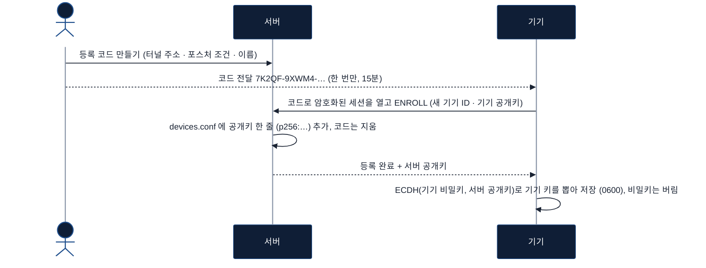

기기는 ID와 고정 키 쌍을 스스로 만들고, 코드로 연 암호화된 세션 안에서 **공개키만** 보냅니다. 서버의 목록에는 공개키만 남아, 목록 파일이 새거나 백업이 흘러도 기기를 사칭할 수 없습니다. 기기 키는 양쪽이 각자 ECDH(기기 비밀키, 서버 공개키) = ECDH(서버 비밀키, 기기 공개키)로 같은 값을 뽑으므로 어디로도 오가지 않습니다. 서버 공개키는 코드를 아는 서버만 열 수 있는 그 세션으로 오므로 기기가 따로 확인할 것이 없습니다. 터널 주소와 포스처 조건은 관리자가 코드를 만들 때 정하고, 기기는 바꿀 수 없습니다.

### 2. 연결하며 서로를 확인하고 세션 키를 만든다

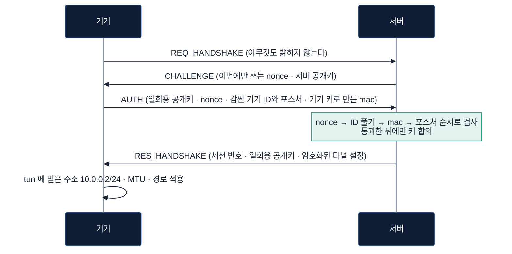

기기는 서버가 방금 뽑은 nonce에 자기 키로 서명해 "내가 그 기기"임을 보입니다. 어느 기기인지(ID)와 그 PC 의 상태(포스처)는 서버 공개키로 감싸 보내므로, 오가는 패킷을 엿보는 쪽은 누가 붙는지 알 수 없습니다. 양쪽은 이번에만 쓰는 ECDH 키로 세션 키를 합의하는데, 여기에 기기 키가 섞여 있어서 서버인 척하는 쪽은 기기가 받아들일 답을 만들지 못합니다. 터널 주소와 "어디를 터널로 보낼지"도 서버가 정해서 내려 주므로, 기기에 적는 것은 서버 주소뿐입니다.

### 3. 통신은 규칙에 있는 곳만 지나간다

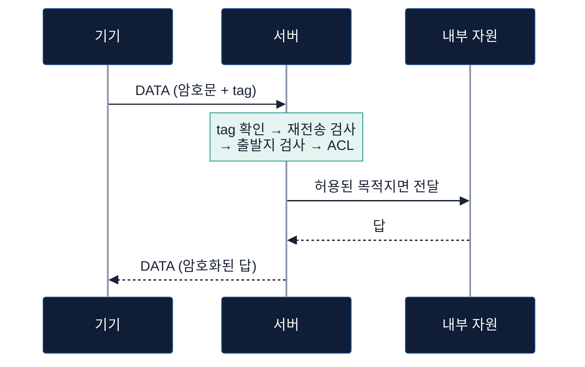

세션의 모든 패킷은 AES-256-GCM으로 감싸입니다. 서버는 tag가 맞는 패킷만 열고, ACL이 허용한 목적지로 갈 때만 내보냅니다. 막힌 패킷은 버리고, 보낸 쪽에 ICMP 3/13(관리자가 막음)으로 알립니다(세션마다 1초 10개까지, 넘치면 조용히 버린다).

### 4. 지속 검증은 한 번 통과한 기기도 계속 본다

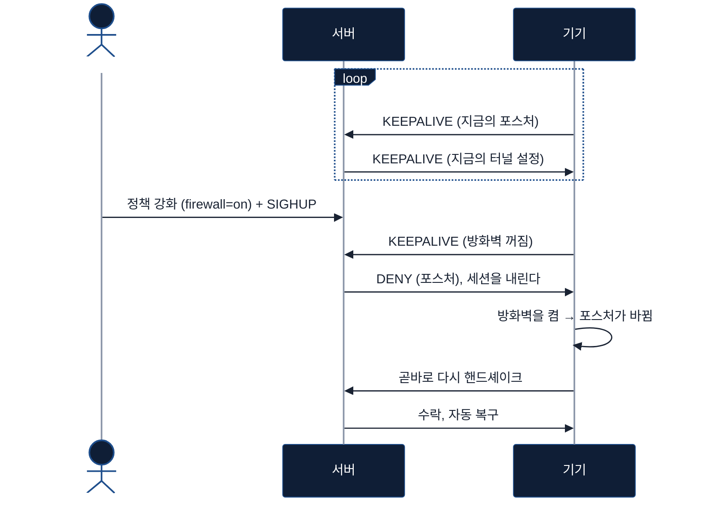

기기는 10초마다 지금의 보안 상태를 다시 보고합니다. 정책에 못 미치면 서버가 세션 중에도 끊고, 기기의 상태가 바뀌면 사용자가 아무것도 누르지 않아도 다시 연결됩니다. CI에서 거절은 SIGHUP 뒤 10초(keepalive 주기) 안에, 복구는 방화벽을 켠 뒤 1~2초(포스처를 읽는 주기) 안에 일어났습니다.

### 5. 사용자 로그인으로 이 기기를 누가 쓰는지 안다

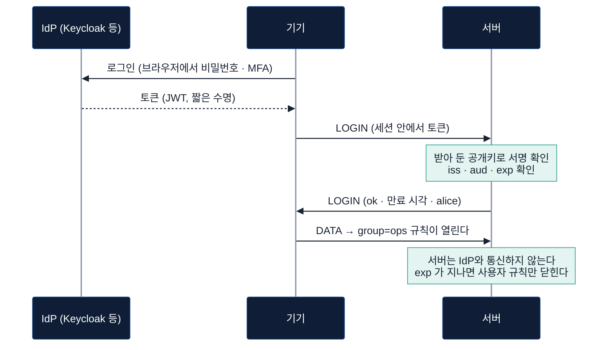

기기 인증은 "등록된 그 장비인가"까지만 말합니다. 사용자가 IdP에서 받은 토큰을 기기가 세션 안으로 보내면, 서버는 미리 받아 둔 IdP의 공개키로 서명을 확인하고 사용자와 그룹을 세션에 붙입니다. ACL의 `user=` 나 `group=` 규칙은 그 사람에게만 열리고, 토큰이 끝나는 순간 닫힙니다. Linux는 기기 인가(`ztgate_login`), Windows는 브라우저 로그인(인가 코드 + PKCE)으로 토큰을 받습니다. CI에서는 IdP 자리에 시험용 OIDC 서버(`tools/idp/mock_oidc.py`)를 두고 갱신과 만료까지 봅니다.

## 서버 구조

왜 이렇게 짰는지(고른 것, 버린 다른 길, 떠안은 것)는 [설계 결정 기록](docs/decisions/README.md)에 한 장씩 있습니다.

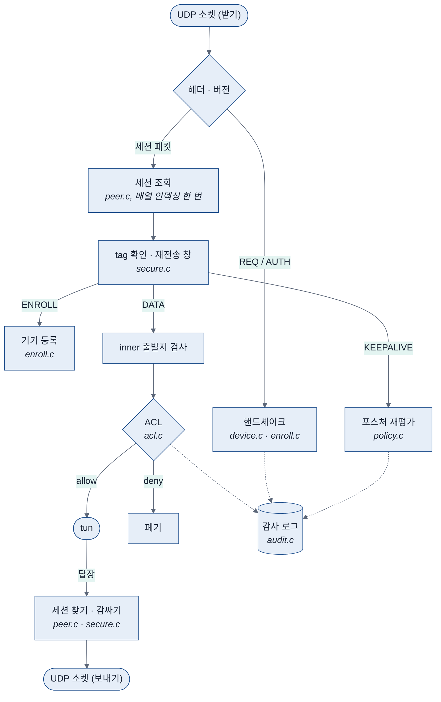

| 부분 | 설계 | 어디 |
|---|---|---|
| **이벤트 루프** | epoll 하나에 UDP 소켓, tun, 상태 소켓을 건다. 기본은 스레드 하나이고, `-w N` 이면 워커마다 같은 루프가 돌며 세션 표를 읽기 / 쓰기 잠금으로 나눠 쓴다 ([0005](docs/decisions/0005-workers-table-rwlock.md)). 1초 타임아웃으로 깨어 세션 만료와 `SIGHUP` 다시 읽기를 처리한다 (시그널 핸들러는 플래그만 세운다) | `server.c` |
| **피어 테이블** | 32bit 세션 번호 = 상위 16bit 난수(`getrandom`) + 하위 16bit 자리 번호. 받은 패킷의 세션은 **배열 인덱싱 한 번**으로 찾고, 번호 전체를 비교해 같은 자리를 다시 쓴 뒤의 옛 번호는 무효다. `MAX_PEERS`(4096) ≤ 2^16 은 `_Static_assert` 로 강제. 송신 쪽(tun → UDP)은 inner 목적지 주소의, 커넥터로 보낼 때는 기기 ID 의 해시 색인으로 찾는다 | `peer.c` |
| **재전송 창** | 세션 패킷의 64bit `counter` 가 GCM nonce 이자 순번이다. 받아들인 가장 큰 값과 그 아래 64개를 비트맵으로 기억해, 순서가 바뀐 패킷은 받고 같은 값은 버린다. 포스처 보고(keepalive)만은 순서대로만 받는다 | `secure.c`, `server.c` |
| **ACL** | `src / dst / proto / dport`, 위에서부터 첫 일치, 일치하는 규칙이 없으면 거부. 규칙마다 포스처 조건을 붙일 수 있다. **상태를 추적하지 않는다** (conntrack 없음). 클라이언트가 보낸 방향에만 걸린다 | `acl.c`, `policy.c` |
| **시계** | 세션 만료, nonce 수명은 `CLOCK_MONOTONIC` 으로 잰다. 시스템 시간을 바꿔도 세션이 한꺼번에 만료되지 않는다 | `peer.c`, `server.c` |
| **로그** | 밖에서 아무나 일으킬 수 있는 줄(위조, 모르는 세션, ACL 거부, 짧은 핸드셰이크)은 종류마다 1초에 20줄까지만 찍고 넘친 수를 한 줄로 알린다. 통과한 패킷마다의 줄은 `-v` 일 때만. 버린 패킷은 상태 소켓의 카운터가 모두 센다 | `server.c` |
| **무중단 정책 변경** | `SIGHUP` 으로 기기 목록, ACL, 등록 대기 목록을 임시 표에 읽어 검사가 끝난 뒤에만 바꿔 끼운다. 파일이 깨져 있으면 이전 것을 그대로 쓴다. 열린 세션은 다음 패킷 / 다음 keepalive 부터 새 정책을 따른다 | `server.c`, `device.c`, `acl.c` |
| **관측** | 읽기 전용 상태 소켓(세션, 포스처, 사유별 거절 수를 JSON 으로), 감사 로그(세션의 시작과 끝, 거절, 목적지별 접근) | `status.c`, `audit.c` |

**열리지 않은 패킷은 세션의 어떤 상태도 바꾸지 못합니다.** 재전송 창에 표시하는 것, 클라이언트의 외부 주소를 갱신하는 것(NAT 뒤에서 포트가 바뀌는 경우), 세션을 내리는 것 모두 tag를 확인한 뒤에 합니다. 위조 패킷 하나로 남의 세션을 끊거나 주소를 돌려놓을 수 없습니다.

| 파일 | 관리자가 고치는 것 | 서버가 하는 일 |
|---|---|---|
| `devices.conf` | 기기 ID, 키, 터널 주소, 포스처 조건 | 여기 있는 기기만 받는다. 등록 코드로 온 기기는 서버가 직접 한 줄을 더한다 |
| `acl.conf` | 누가 어디로 갈 수 있는가 (+ 규칙별 포스처 조건) | 패킷마다 대 보고, `allow`의 목적지 대역을 그 기기의 경로로 내려 준다 |
| `enroll.conf` | (관리 도구가 관리) 발급한 등록 코드에서 뽑은 임시 신원 | 그 코드로 온 기기를 받고, 쓰인 줄을 지운다 |
| `audit.log` | (없음) | 세션의 시작과 끝, 거절, 목적지별 접근, 정책 변경을 한 줄씩 남긴다 |

### Linux 클라이언트

| 부분 | 설계 | 어디 |
|---|---|---|
| **프로토콜** | 핸드셰이크, 등록, 세션 송신을 `session.c` 하나에 둔다. 부하 생성기도 같은 코드를 쓴다. 서버에 `connect()` 한 UDP 소켓이라 서버가 아닌 곳에서 온 패킷은 커널이 거른다 | `client/src/session.c` |
| **루프** | 서버와 같은 epoll 루프. tun → 감싸기 → send, recv → 열기 → 종류별 분기. keepalive 10초, 포스처 2초마다 읽기, 서버가 30초 조용하면 재핸드셰이크 | `client/src/client.c` |
| **신원** | `id key` 한 줄, 0600, 내 소유가 아니거나 권한이 넓으면 읽지 않는다. 임시 파일에 쓰고 fsync 한 뒤 rename | `client/src/identity.c` |
| **포스처** | 커널 버전(`LINUX_VERSION_CODE` 모양), nftables 의 인바운드 기본 거부 또는 firewalld. 백신 칸은 Linux 에 대응하는 것이 없어 "모름" | `client/src/posture.c` |
| **설정 적용** | 서버가 준 주소·prefix·MTU·경로를 ioctl 로 넣는다. 바뀐 부분만 고치고, `/0` 과 서버 주소를 덮는 경로는 넣지 않는다 | `client/src/netcfg.c` |

### 함께 쓰는 코드

`lib/common`은 Linux 서버, Linux 클라이언트, Windows 클라이언트가 **같은 소스를 빌드**합니다.

| 파일 | 내용 |
|---|---|
| `proto.{h,c}` | 와이어 헤더, 메시지 종류, 포스처 보고와 터널 설정의 직렬화 |
| `secure.{h,c}` | 세션 키 유도, 패킷 감싸기 / 풀기, 재전송 창, 등록 코드에서 임시 신원 뽑기, selftest 벡터 |
| `crypt.h` | 암호 도구의 선언. Linux 쪽은 OpenSSL(`crypt_openssl.c`), Windows는 CNG(`windows/core/crypt.c`)가 채운다 |

OS별로 갈라지는 것은 알고리즘 호출뿐이고, 양쪽 `selftest`가 같은 표준 벡터(FIPS 180-4, RFC 4231, RFC 5869, GCM 명세, RFC 5903)를 통과하는 것이 서로 통한다는 근거입니다.

## 프로토콜

### 패킷의 모양

모든 UDP 페이로드는 `msg_header`로 시작합니다. 세션이 열린 뒤의 패킷은 종류와 관계없이 같은 모양입니다.

```
 0        1        2                 4                                   8
 +--------+--------+-----------------+-----------------------------------+
 | version|  type  |    reserved     |         session_idx (BE)          |  msg_header  (8B)  ┐ 암호화하지 않지만
 +--------+--------+-----------------+-----------------------------------+                    │ tag 가 함께 덮는다
 |                         counter (BE, 64bit)                           |  data_header (8B)  ┘
 +-----------------------------------------------------------------------+
 |                  암호문 (AES-256-GCM) ...                             |
 +-----------------------------------------------------------------------+
 |                         tag (16B)                                     |
 +-----------------------------------------------------------------------+
```

터널 오버헤드는 바깥 IPv4(20) + UDP(8) + 헤더(16) + tag(16) = **60바이트**이고, 그래서 터널 MTU 기본값이 1400입니다.

| type | 값 | 내용 |
|---|---|---|
| `REQ_HANDSHAKE` | 1 | 0 (80B). `CHALLENGE` 만큼 채워 출발지를 위조한 요청으로 남에게 더 큰 답을 보내게 할 수 없다 |
| `RES_HANDSHAKE` | 2 | 세션 번호(헤더) + 서버의 일회용 공개키 (64B) + 암호화된 터널 설정 + tag |
| `DATA` | 3 | 세션 패킷. 암호문 = inner IPv4 패킷 |
| `KEEPALIVE` | 4 | 세션 패킷. C→S: 포스처 (8B) / S→C: 지금의 터널 설정 |
| `CHALLENGE` | 5 | nonce (16B) + 서버 공개키 (64B) |
| `AUTH` | 6 | 클라이언트의 일회용 공개키 (64B) + nonce (16B) + 감싼 (기기 ID + 포스처) (24B) + tag (16B) + mac (32B) |
| `DENY` | 7 | 핸드셰이크 중: 사유 (1B) + mac (32B) / 세션 중: 세션 패킷, 암호문 = 사유 |
| `ENROLL` | 8 | 세션 패킷, 등록 코드로 연 세션에서만. C→S: 기기 ID + 키 / S→C: 결과 (1B) |
| `LOGIN` | 9 | 세션 패킷. C→S: 사용자의 토큰 (JWT) / S→C: 결과 (1B) + 만료 시각 (8B) + 사용자 이름 |
| `DISCONNECT` | 10 | 세션 패킷. 사유 (1B): 1 클라이언트가 끝남 / 2 서버가 끝남 / 3 세션 키의 수명이 다함. 받은 쪽은 그 세션을 바로 닫는다 (클라이언트는 바로 다시 핸드셰이크한다). 답은 없다 |
| `VERSION` | 11 | 서버가 받지 않는 버전의 `REQ_HANDSHAKE` 에: 받는 가장 낮은 버전 (1B) + 가장 높은 버전 (1B). 헤더의 버전은 서버의 것이고, 이 모양은 버전이 올라가도 그대로다 ([ADR 0012](docs/decisions/0012-version-compat.md)) |

### 세션 키

```
secret = ECDH(이번 핸드셰이크의 일회용 P-256 키 쌍)
prk    = HKDF-Extract(salt = 기기 키, ikm = secret)
keys   = HKDF-Expand(prk, "ztgate v6 session" | SHA-256(AUTH 패킷 | RES 의 헤더와 pub_s), 96B)
       = C→S 키 | S→C 키 | RES_HANDSHAKE 키
nonce  = 0x00000000 | counter (8B)            패킷마다, 방향마다 다른 키
```

| 세션 키에 들어가는 것 | 그래서 |
|---|---|
| **기기 키** | 그 키를 모르는 쪽은 사이에 끼어 자기 일회용 키를 내밀어도 같은 세션 키에 닿지 못한다. 서버에 인증서를 두지 않아도 `RES_HANDSHAKE`의 tag가 맞았다는 것이 "상대가 이 기기의 키를 아는 서버"라는 증명이다 |
| **일회용 ECDH** | 기기 키가 나중에 새도 녹화해 둔 트래픽은 풀리지 않는다. 서버의 기기 목록에는 모든 기기의 키가 있어서, 이것이 없으면 서버가 한 번 뚫리는 날 지난 세션이 전부 풀린다 |
| **주고받은 패킷의 해시** | 도중에 한 바이트라도 바뀌었으면 양쪽의 키가 달라져 첫 패킷부터 열리지 않는다 |
| **방향마다 다른 키** | 양쪽이 `counter`를 0부터 세도 같은 (키, nonce)가 생기지 않고, 보낸 패킷을 되돌려 보내도 열리지 않는다 |

<details>
<summary><b>핸드셰이크의 세부</b>. 거절의 사유, 검사 순서, 방해에 대한 방어</summary>

<br/>

| 사유 | 값 | 뜻 |
|---|---|---|
| `DENY_UNKNOWN_DEVICE` | 1 | 기기 목록에 없는 ID (또는 쓸 수 없는 등록 코드) |
| `DENY_BAD_AUTH` | 2 | nonce가 다르거나 만료됐거나 mac이 틀림 |
| `DENY_TUN_IP` | 3 | (버전 3까지) 지금은 터널 IP를 서버가 내려 주므로 보내지 않음 |
| `DENY_POSTURE` | 4 | 인증은 됐지만 포스처가 그 기기의 정책에 못 미침 |

- **챌린지-응답**이라 키 자체는 와이어에 나오지 않습니다. nonce는 5초 뒤 만료되고 기기마다 한 번만 쓰입니다. 서버는 그 기기가 마지막으로 쓴 nonce 의 발급 시각을 기억해 그보다 늦게 발급된 것만 받습니다.
- **서버는 `REQ`에 상태를 남기지 않습니다.** nonce 는 발급 시각과, 그 시각 | 출발지 IP 에 서버만 아는 키로 붙인 mac 입니다 (상태 없는 쿠키). 그래서 `REQ`를 쏟아부어도 표가 차지 않고, 남이 보낸 `REQ`가 진짜 기기의 nonce 를 밀어내지 못하고, 서명이 틀린 `AUTH`는 그 기기의 상태를 바꾸지 않습니다.
- **기기 ID 와 포스처는 감싸서 갑니다** (v9). `AUTH` 의 일회용 공개키와 `CHALLENGE` 의 서버 공개키로 ECDH 해 뽑은 키로 AES-256-GCM. 같은 기기의 `AUTH` 도 매번 다른 바이트라 엿보는 쪽은 기기를 알아보지 못합니다. 서버 공개키는 서버 키(`-k`)의 것이고, 서버 키가 없으면 서버가 뜰 때 만든 일회용 키의 것입니다.
- **검사 순서**는 nonce → ID 풀기 → mac → 포스처입니다. 그 출발지에 방금 내준 nonce 가 아니면 ID 를 풀어 보는 계산(ECDH)도 하지 않습니다. 키를 가졌다는 것을 확인하기 전에는 구체적인 거절 이유를 알려 주지 않고, 세션 키 합의도 그 뒤에 합니다.
- **감싼 부분과 일회용 공개키는 mac의 범위 안**이라 전달 도중에 "방화벽 꺼짐"을 "켜짐"으로 고치거나 공개키를 바꿔 끼울 수 없습니다.
- 클라이언트는 `AUTH`를 보내기 전에 온 수락과 **tag가 맞지 않는 수락을 받지 않습니다.**
- **거절을 믿어도 되는가.** 인증 뒤의 거절(포스처)에는 기기 키로 만든 mac이 붙습니다. 그 전의 거절은 서버가 상대의 키를 확인하지 못한 상태라 mac이 없고, 클라이언트는 이런 거절을 곧바로 믿지 않고 진짜 서버의 답을 끝까지 기다린 뒤 다른 답이 없을 때에만 받아들입니다. 세션 중의 거절은 세션 키로 감쌉니다.
- 새로 인증하면 새 세션입니다. 세션 번호도, 키도, counter도 새로 시작합니다.

</details>

<details>
<summary><b>터널 설정</b>. 서버가 주소와 경로를 내려 주는 방식</summary>

<br/>

```
tun_ip(4) | prefix_len(1) | n_routes(1) | mtu(2) | n_routes x ( addr(4) | prefix_len(1) )
| n_dns(1) | n_domains(1) | n_dns x addr(4) | n_domains x ( len(1) | 이름 )        ← v7
```

| 값 | 어디서 오는가 |
|---|---|
| 터널 주소 | 기기 목록에 그 기기 앞으로 적힌 주소 |
| 대역의 prefix, MTU | 서버를 띄울 때의 `-n` / `-m` |
| 경로 | ACL에서 그 기기의 터널 주소가 출발지에 걸리는 `allow` 규칙들의 목적지 대역 |
| 내부 DNS (v7) | 서버의 `dns.conf` (`-d`). 서버 2개, 도메인 4개까지 |

- **경로는 ACL에서 뽑습니다.** 경로 목록을 따로 두면 둘이 어긋납니다. 경로는 있는데 규칙이 없어 터널로 들어간 패킷이 버려지거나, 규칙은 있는데 경로가 없어 터널로 가지도 않습니다.
- **빼는 것.** `deny` 규칙, 터널 대역 안의 목적지, 목적지가 `any`인 규칙.
- **`RES_HANDSHAKE`와 서버의 keepalive 응답에 통째로 실립니다.** 클라이언트는 받은 것과 지금 적용한 것을 비교하기만 하면 됩니다.
- **클라이언트는 달라진 부분만 고칩니다.** 터널 주소가 바뀐 경우만 다시 핸드셰이크합니다.
- **클라이언트는 받은 경로를 그대로 믿지 않습니다.** `/0`과 서버 자신의 주소를 덮는 대역은 넣지 않습니다.

</details>

<details>
<summary><b>등록 코드</b>. 새 핸드셰이크를 만들지 않은 이유</summary>

<br/>

```
id  = HMAC-SHA256("ztgate enroll id",  코드) 의 앞 16B     서버가 코드를 찾는 이름표
key = HMAC-SHA256("ztgate enroll key", 코드)               코드를 아는 쪽만 만드는 비밀
```

코드에서 임시 신원을 뽑아 **평소의 핸드셰이크를 그대로 돕니다.** 코드를 모르는 쪽은 세션을 열지 못하고, 서버인 척하는 쪽은 수락을 만들지 못하고, 기기의 진짜 키는 그 세션의 키로 감싸여 가므로 코드를 나중에 알게 된 사람도 녹화해 둔 등록에서 키를 꺼내지 못합니다. 새로 생긴 것은 `ENROLL` 메시지 하나입니다.

- 코드는 0-9와 헷갈리는 글자(I L O U)를 뺀 대문자 25자, 125비트입니다.
- **한 번 쓰면 지워지고, 쓰지 않아도 만료됩니다.** (`linux_e2e.sh`가 같은 코드의 두 번째 사용이 거절되는 것을 확인)
- **등록용 세션으로는 등록 말고 아무것도 하지 못합니다.**
- **기기가 정할 수 있는 것은 자기 신원뿐입니다.** 터널 주소, 포스처 조건, 이름은 관리자가 코드를 만들 때 정한 것이 그대로 적힙니다.
- 기기는 **서버가 받아 준 뒤에** 신원을 저장합니다.

</details>

<details>
<summary><b>사용자 로그인</b>. 토큰을 어디에 싣고, 서버가 무엇을 믿는가</summary>

<br/>

- **토큰은 핸드셰이크가 아니라 세션이 열린 뒤에 보냅니다.** `AUTH`는 암호화되지 않으므로 거기에 실으면 토큰이 그대로 보이고, 토큰은 가진 사람이 곧 그 사용자인 증표입니다. 세션 패킷은 서버만 열 수 있고, 수락의 tag로 상대가 진짜 서버임도 이미 확인했습니다. 메시지 하나(`LOGIN`)만 늘었고 핸드셰이크는 그대로입니다.
- **로그인은 세션의 조건이 아니라 규칙의 조건입니다.** 로그인하지 않은 세션도 열리고, 기기만으로 갈 수 있는 곳(사용자 조건이 없는 규칙)은 그대로 갑니다. 그래서 사용자 로그인을 서버에 붙이는 순간 모든 기기가 끊기지 않고, 사람이 로그인하기 전에 도는 것(업데이트, 백업 에이전트)도 따로 열어 둘 수 있습니다.
- **서버는 IdP와 통신하지 않습니다.** 관리자가 받아 둔 JWKS로 서명만 확인합니다. 그래서 IdP가 잠깐 닿지 않아도 이미 받은 토큰은 계속 쓰이고, 데이터 경로에 네트워크 대기가 들어오지 않습니다. 대가로 토큰을 IdP에서 폐기해도 `exp`까지는 쓰입니다. 토큰 수명을 짧게(분 단위) 두고 `ztgate_login --keep`이 갈아 끼우게 하는 것이 그 보완입니다.
- **만료는 패킷마다 봅니다.** keepalive(10초)에서만 보면 토큰이 끝난 뒤에도 최대 10초 동안 그 사용자의 권한이 남습니다. 벽시계는 사용자 조건이 걸린 규칙에 닿았을 때만 읽으므로, 그런 규칙이 없는 정책의 데이터 경로에는 비용이 없습니다.
- **틀린 토큰은 있던 로그인을 떼지 않습니다.** 갱신하다 실패했다고 아직 유효한 로그인까지 잃을 이유가 없습니다. 다른 사용자의 맞는 토큰은 그 사용자로 바꿉니다.
- **JSON은 직접 읽습니다** (`server/src/json.c`). 원문을 한 번 훑어 토큰 배열을 만드는 방식이라 메모리를 따로 잡지 않고, 받아 준 JSON을 다른 구현이 다르게 읽는 일이 없도록 같은 키가 두 번 나오는 객체, 끝의 쉼표, 이스케이프된 키를 받지 않습니다.

</details>

<details>
<summary><b>keepalive와 세션의 수명</b></summary>

<br/>

| 상수 (`proto.h`) | 값 | 의미 |
|---|---|---|
| `KEEPALIVE_INTERVAL_SEC` | 10 | 클라이언트의 keepalive(포스처 보고) 주기 |
| `SERVER_TIMEOUT_SEC` | 30 | 클라이언트가 이 시간 동안 서버에서 아무것도 받지 못하면 재핸드셰이크 |
| `SESSION_TIMEOUT_SEC` | 60 | 서버가 이 시간 동안 수신이 없는 세션을 만료 |

- keepalive는 NAT 매핑 유지, 생존 확인, **포스처 재보고**, **터널 설정 갱신**을 겸합니다.
- **데이터는 순서가 바뀌어도 받고, 포스처 보고는 순서대로만 받습니다.** 보고는 "지금의 상태"라서, 방화벽이 켜져 있던 때의 보고를 붙잡아 두었다가 끈 뒤에 풀어 놓는 것을 막아야 합니다.
- 거절된 클라이언트는 터널을 닫지 않고 통과만 막은 채, 포스처가 바뀌면 바로, 그렇지 않아도 30초마다 다시 핸드셰이크합니다.
- 서버는 세션이 마지막으로 보고한 포스처로 ACL 규칙의 포스처 조건을 판정합니다. 기기 정책은 통과하지만 규칙의 조건에는 못 미치면 세션은 유지되고 그 목적지만 닫힙니다.

</details>

<details>
<summary><b>패킷이 지나는 길</b>. 송신, 수신, 검증 순서</summary>

<br/>

**서버의 송신 (TUN → UDP).** 버퍼의 앞 16바이트(헤더)와 뒤 16바이트(tag) 자리를 남기고 읽은 뒤, 읽은 자리에서 암호화합니다. 패킷을 옮기지 않습니다.

```
read(tun, buf + 16)     [ ........ 16B ........ ][ IP packet (n) ][ ... 16B ... ]
secure_seal(buf, n)     [ msg_hdr ][ counter   ][   암호문 (n)   ][    tag     ]
sendto(buf, n + 32)     └────────────────── 한 번에 전송 ──────────────────────┘
```

**서버의 수신 (UDP → TUN).**

1. 헤더 길이와 프로토콜 버전
2. `REQ_HANDSHAKE` 나 `AUTH` 면 핸드셰이크로
3. 세션 번호로 세션 조회
4. **세션 키로 열기.** tag가 맞지 않거나 이미 받은 `counter`면 여기서 버린다
5. 등록용 세션이면 `ENROLL`만 받는다
6. 종류별 분기 (keepalive → 포스처 재평가)
7. IPv4 형식 검사
8. inner 출발지가 그 세션의 터널 주소인가
9. ACL (규칙 파일이 없으면 터널 대역 안인가). 결과를 감사 로그에
10. 모두 통과한 뒤에만 외부 주소와 `last_seen` 갱신, tun에 쓴다

**클라이언트의 수신.** 출발지가 서버인가(Linux 는 `connect()` 로 커널이 거른다) → 헤더와 버전 → 내 세션 번호인가 → 세션 키로 열기 → 종류별 분기. "서버가 살아 있다"는 표시도 tag를 확인한 뒤에 합니다.

</details>

## 보안 모델

무엇을 막고, 무엇을 아직 막지 못하는지 적습니다. 마지막 열은 그것을 무엇으로 확인했는지입니다.

| 위협 | 상태 | 어떻게 | 확인 |
|---|---|---|---|
| 등록되지 않은 기기의 접속 | ✅ | 기기 목록에 있는 기기가 자기 키로 서버의 nonce에 서명해야 세션을 받는다 | auth_check |
| 도청 | ✅ | 세션의 모든 패킷을 AES-256-GCM으로 암호화. 일회용 ECDH라 기기 키가 나중에 새도 지난 세션은 풀리지 않는다 | auth_check (서버의 세션 패킷을 독립 구현으로 열어 본다). 와이어에 평문이 없는지는 캡처로 볼 것 (실험 1) |
| 패킷 주입 / 변조 | ✅ | 세션 키로 만든 tag가 맞아야 받는다. 헤더(종류, 세션 번호, `counter`)도 tag의 범위 안 | auth_check |
| 재전송 | ✅ | `AUTH`는 1회용 nonce, 세션 패킷은 64개 폭의 창, 포스처 보고는 순서대로만 | auth_check |
| 서버 위장 | ✅ | 세션 키에 기기 키가 들어가므로 그 키를 모르는 쪽은 클라이언트가 받아들일 수락을 만들지 못한다 | 코드 검토 (클라이언트 쪽 자동 시험 없음) |
| 위조 패킷으로 남의 세션 끊기 / 주소 돌리기 | ✅ | 세션 키로 열린 패킷만 세션의 상태를 바꾼다 | auth_check |
| 핸드셰이크 방해 | ✅ | 서버는 `REQ`에 상태를 남기지 않고, 서명이 틀린 `AUTH`는 그 기기의 상태를 바꾸지 않는다. 다른 주소에 내준 nonce 는 받지 않는다 | auth_check |
| 쓰레기 패킷으로 서버 지치게 하기 | ⚠️ | `REQ` 에는 HMAC 한 번만 하고 상태를 남기지 않는다. ECDH 는 그 출발지에 방금 내준 nonce 가 붙은 `AUTH` 에만 한다. 출발지를 위조한 패킷은 HMAC 한 번으로 끝난다 (상태 없는 쿠키). 그런 패킷이 남기는 로그는 1초에 종류마다 20줄로 묶인다. 실제 주소에서 보내는 쪽은 `AUTH` 마다 ECDH 한 번을 시킬 수 있지만 주소마다 초당 20개(`-r`)까지이고, 그 ECDH 는 표 잠금 밖에서 한다. `REQ` 는 잠금 없이, 없는 세션 번호로 온 패킷은 읽기 잠금 안에서 버리므로 쓰레기 패킷이 쓰기 잠금을 잡아 다른 워커의 데이터를 멈추게 하지 못한다 | auth_check (300개 → 40줄 이하, AUTH 속도 제한) |
| 세션 안에서 출발지 주소 위조 | ✅ | inner 출발지가 그 세션의 터널 주소와 다르면 버린다 | auth_check |
| 정책 밖 목적지 접근 | ✅ | ACL 기본 거부. 규칙 파일이 없으면 터널 대역 안까지만 | auth_check, linux_e2e |
| 정책에 못 미치는 단말 | ✅ | 핸드셰이크와 매 keepalive에서 기기별 포스처 정책 평가, ACL 규칙별 포스처 조건 | auth_check, linux_e2e |
| 분실 / 폐기된 기기 | ✅ | 목록에서 지우면 다음 keepalive(10초 이내)에서 차단 | auth_check |
| 등록할 때 키가 새는 것 | ✅ | 기기는 공개키만 올리고, 기기 키는 양쪽이 고정 키의 ECDH 로 따로 뽑는다. 기기 키는 어디로도 오가지 않는다. 코드는 일회용이고 만료된다 | auth_check, linux_e2e, Windows 콘솔로 실서버에 등록하고 그 키로 핸드셰이크 |
| 서버의 기기 목록이 새는 것 | ✅ | 등록 코드로 올라온 기기는 목록에 공개키(`p256:`)만 있다. 서버의 비밀은 서버 키 파일 하나 | auth_check |
| 다른 사용자인 척 (위조 토큰) | ✅ | IdP의 공개키로 서명 확인. RS256, ES256만, `kid`와 키 종류가 맞아야 한다. `alg: none`, HS256 키 혼동, 서명 뒤 변조, 모르는 키를 거절 | auth_check (21가지 거절), keycloak_check |
| 다른 앱에 준 토큰, 끝난 토큰 | ✅ | `iss`, `aud`, `exp`, `nbf`를 본다. 세션 중에 만료되면 그 순간부터 사용자 규칙이 닫힌다 | auth_check, linux_e2e, keycloak_check (`aud`) |
| 토큰이 도청되는 것 | ✅ | 토큰은 세션 패킷 안에서만 오간다. 클라이언트는 수락의 tag로 서버를 확인한 뒤에 보낸다 | 코드 검토 |
| 훔친 토큰을 다른 기기에서 쓰는 것 | ✅ | DPoP: 기기 키에 묶인 토큰(`cnf.jkt`)은 그 키의 증명과 함께여야 받는다. `dpop required` 면 묶이지 않은 토큰은 받지 않는다 (기본은 받는다. IdP 가 DPoP 를 지원해야 하기 때문이다). 등록된 기기의 키도 함께 있어야 세션이 열린다 | auth_check (19가지), linux_e2e, keycloak_check (실제 IdP 의 묶인 토큰), Windows 증명을 서버가 확인 |
| 내부망에 들어오는 포트 | ✅ | 커넥터가 서버로 밖으로만 세션을 연다. 커넥터 장비는 LAN → 터널을 이미 있는 연결의 답만 들인다 | linux_e2e |
| 커넥터를 앞세운 위조 | ✅ | 커넥터가 보낸 패킷은 출발지가 맡은 대역 안이고 목적지가 붙어 있는 클라이언트일 때만 전달한다 | auth_check |
| IdP에서 막은 사용자 | ⚠️ | 서버는 IdP에 묻지 않으므로 이미 받은 토큰은 `exp`까지 쓰인다. 토큰 수명을 짧게 둔다 | (없음) |
| 가짜 거절로 접속 방해 | ⚠️ | 인증 뒤의 거절은 확인한다. 인증 전의 거절은 확인할 수 없어 진짜 답을 끝까지 기다린다. 경로 위에서 패킷을 지울 수 있는 공격자는 여전히 막을 수 있다 | 코드 검토 |
| 가로챈 등록 코드 | ❌ | 만료 전의 코드를 가진 사람이 그 자리의 기기가 된다. 누가 올라왔는지는 감사 로그에 남는다 | (없음) |
| 기기 추적 / 단말 상태 엿보기 | ⚠️ | 기기 ID 와 포스처는 서버 공개키로 감싸 간다 (v9). 엿보기만 하는 쪽에게는 매번 다른 바이트다. 등록 코드로 올라간 기기는 그때 받은 서버 공개키를 기억해 다른 공개키를 내미는 `CHALLENGE` 에 답하지 않으므로, 경로 위에서 공개키를 바꿔 끼우는 공격자에게도 ID 가 보이지 않는다. 손으로 올린 기기와 등록 자체의 첫 핸드셰이크는 `CHALLENGE` 의 공개키를 그대로 믿는다. 언제 얼마나 주고받는지는 보인다 | auth_check (와이어에 ID / 포스처가 없는가, 다른 키로 감싼 ID 거절), linux_e2e (다른 서버 공개키에 답하지 않는가) |
| 포스처 거짓 보고 | ❌ | 포스처는 클라이언트의 자기 보고다. 키를 가진 변조된 클라이언트는 거짓으로 보고할 수 있다 (막으려면 TPM 기반 원격 증명이 필요) | (없음) |

## 표준 프로토콜과의 대조

같은 문제를 표준은 어떻게 푸는지, 이 프로젝트는 무엇을 단순화했고 그래서 어디가 약한지 적습니다.

> 실험 8(같은 서버에 WireGuard 를 올려 핸드셰이크를 나란히 캡처)의 결과로 이 절을 보강할 예정입니다. 지금 내용은 설계와 명세를 비교한 것입니다.

### 핸드셰이크 ↔ IKEv2

| | IKEv2 (RFC 7296) | 이 프로젝트 |
|---|---|---|
| 메시지 | 2왕복: `IKE_SA_INIT`(DH 공개값, nonce, 알고리즘 제안) → `IKE_AUTH`(암호화된 신원과 인증) | 2왕복: `REQ`(빈 채움) → `CHALLENGE`(nonce, 서버 공개키) → `AUTH`(공개값, 감싼 ID와 포스처, mac) → `RES`(공개값, 암호화된 설정) |
| 인증 | 인증서, PSK, EAP | 기기별 256bit 대칭 키(PSK 와 같은 성격)로 만든 HMAC |
| 키 합의 | 일회용 DH → PRF+ 로 IKE SA 키, 그 위에 Child SA 키 | 일회용 ECDH P-256 → HKDF(salt = 기기 키) 로 방향별 키 셋 |
| 알고리즘 | 제안과 선택 (협상) | 고정 (P-256, HKDF-SHA256, AES-256-GCM) |
| DoS | 응답자가 부하를 받으면 `COOKIE` 로 출발지 주소부터 확인 | nonce 가 늘 쿠키다 (발급 시각 + 출발지 IP 의 mac). 그것이 맞은 `AUTH` 에만 ECDH |
| 재키잉 | `CREATE_CHILD_SA` 로 세션 중에 키 교체 | 없음. 다시 핸드셰이크할 때만 키가 바뀐다 |

- **같은 점.** 일회용 DH 로 전방 비밀성을 얻고, 주고받은 메시지를 키 유도(또는 서명)에 묶어 중간 변조를 잡는다. 확인 전에는 비싼 일을 하지 않는다.
- **단순화.** 협상이 없어 메시지가 짧고 다운그레이드 공격면이 없지만, 알고리즘을 바꾸려면 프로토콜 버전을 올려야 한다. 신원은 IKEv2 처럼 합의한 키로 감싸지만, 그 키는 응답자의 공개키(`CHALLENGE`)와 개시자의 일회용 키로 한 쪽만 일회용인 ECDH 다. `IKE_SA_INIT` 의 양쪽 일회용 DH 보다 한 단계 짧다.
- **그래서 약한 곳.** 등록 코드로 올라간 기기는 서버 공개키를 고정해 두지만, 손으로 올린 기기는 `CHALLENGE` 의 공개키를 확인하지 못하므로 능동 공격자가 공개키를 바꿔 끼워 기기 ID 를 볼 수 있다 (IKEv2 도 개시자의 신원을 응답자를 인증하기 전에 보낸다. 같은 성질이다). 출발지를 위조한 `REQ` 의 답은 `REQ` 와 크기가 같아 증폭이 없다. 세션 키는 끊고 다시 여는 방식으로만 바뀐다.

### 데이터 패킷 ↔ ESP

| | ESP (RFC 4303, GCM 은 RFC 4106) | 이 프로젝트 |
|---|---|---|
| 식별 | SPI (32bit) | `session_idx` (32bit, 하위 16bit 가 테이블 자리) |
| 순번 | Sequence Number 32bit, ESN 이면 64bit 중 하위 32bit 만 와이어에 | `counter` 64bit 를 와이어에 전부 |
| nonce | salt(4B, 키에서) + 명시적 IV(8B, 패킷에) | `0x00000000` + `counter`. IV 를 따로 싣지 않는다 (RFC 8750 의 암묵적 IV 와 같은 생각) |
| 인증 범위 | ESP 헤더(SPI, 순번) + 암호문 | 헤더(버전, 종류, 세션 번호) + `counter` + 암호문 |
| 패딩 / 다음 헤더 | 있음 (전송 / 터널 모드, 트래픽 흐름 은닉용 패딩) | 없음. 터널 모드 IPv4 만 |
| 전송 | IP 프로토콜 50, NAT 뒤에서는 UDP 4500 캡슐화 | 처음부터 UDP |

- **같은 점.** SPI 로 SA 를 찾듯 세션 번호로 세션을 찾고, 순번이 곧 재전송 방지 수단이며, AEAD 하나로 암호화와 무결성을 함께 얻는다.
- **단순화.** 순번을 64bit 그대로 실어 ESN 의 상위 비트 추정이 필요 없다(대신 패킷마다 4바이트 더). salt 가 없어 nonce 가 `counter` 만으로 정해지므로, 방향마다 키를 달리하는 것으로 (키, nonce) 중복을 막는다.
- **그래서 약한 곳.** 패딩이 없어 암호문 길이가 평문 길이를 그대로 드러낸다. 프로토콜 번호 대신 UDP 라 NAT 를 쉽게 지나지만, 방화벽이 "VPN 트래픽"으로 알아보는 표시도 없다.

### 재전송 창 ↔ ESP 시퀀스 윈도우

| | ESP (RFC 4303 §3.4.3) | 이 프로젝트 |
|---|---|---|
| 창 | 최소 32, 기본 64 를 권고. 받은 가장 큰 순번 아래를 비트맵으로 | 64. 같은 방식 (`secure.c`, 가장 큰 값 + 비트맵) |
| 순서가 바뀐 패킷 | 창 안이면 받는다 | 같다 |
| 실패한 패킷 | 무결성 확인을 통과한 뒤에만 창을 갱신 | 같다. tag 가 맞은 뒤에만 표시한다 |
| 포스처 보고 | (없음) | 창과 별도로 "직전보다 커야 한다"(엄격한 순서) |

- **그래서 약한 곳.** 창이 64 라 고속 링크에서 경로가 패킷을 64개 이상 뒤섞으면 정상 패킷도 버려진다. 더 넓은 창은 메모리와 맞바꾸는 문제다.

### 키 합의 ↔ WireGuard (Noise IK)

| | WireGuard | 이 프로젝트 |
|---|---|---|
| 왕복 | 1왕복 (initiation → response) | 2왕복 (nonce 를 서버가 먼저 준다) |
| 신원 | 정적 공개키. 개시자의 공개키는 암호화돼 간다 | 기기 ID(서버 공개키로 감싸 간다) + 기기 키 |
| 재전송 방지(핸드셰이크) | TAI64N 타임스탬프 | 서버가 준 nonce 의 발급 시각 (기기마다 늘어나야 한다) |
| 서버가 가진 것 | 피어의 **공개키**만 | 모든 기기의 **대칭 키** |
| 거절 | 응답하지 않는다 (인증되지 않은 패킷에 침묵) | `DENY` 로 사유를 알린다 (인증 전에는 사유를 뭉뚱그림) |
| 키 교체 | 2분마다 자동 재핸드셰이크 | 없음 |
| DoS | 부하 시 쿠키 응답 (mac2) | nonce 가 늘 쿠키다 (상태 없음) |

- **같은 점.** 매 핸드셰이크 일회용 DH, 협상 없는 고정 암호 묶음, 세션 패킷의 카운터가 nonce 이자 재전송 창의 순번.
- **단순화.** Noise 의 정적-정적 DH 대신 대칭 기기 키를 HKDF 의 salt 로 섞는다. 서버가 nonce 를 주므로 시계에 기대지 않지만 왕복이 하나 늘어난다.
- **그래서 약한 곳.** 서버가 뚫리면 모든 기기의 키가 드러나 그 기기들로 가장할 수 있다 (WireGuard 서버가 뚫려도 피어의 개인키는 나오지 않는다). WireGuard 의 개시자는 응답자의 공개키를 미리 안다. 여기서는 등록 코드로 올라간 기기만 그렇고(등록 때 받아 고정), 손으로 올린 기기는 `CHALLENGE` 로 받으므로 능동 공격자에게 기기 ID 가 보인다. `DENY` 에 답하므로 포트 스캔에 서버의 존재가 드러난다.

## 테스트

| 무엇을 | 어떻게 | 어디서 |
|---|---|---|
| Linux 서버 ↔ Linux 클라이언트 | `test/linux_e2e.sh`. netns 두 개에서 등록 → 연결(서버가 준 주소·MTU·경로) → ACL 차단 → 포스처 거부와 nft 로 방화벽을 켠 뒤의 복구 → 로그인 도구로 받은 토큰의 로그인, 갱신, 만료 → 커넥터를 지나 내부망 자원에 닿기, 내부망에서 시작한 연결 차단 → UDP 를 막은 뒤 TCP 로 붙기 → 다른 서버 공개키에 답하지 않기 → 답이 없는 서버 건너뛰기와 연결 중 다른 서버로 넘어가기 → DPoP 로 묶인 토큰 → IPv6 로 서버에 붙기. 67개 | CI, 한 장비 |
| 서버의 프로토콜 | `sudo python3 test/auth_check.py`. 클라이언트인 척 UDP 패킷을 직접 만들어 보낸다. **356개.** 세션 키 유도와 패킷 형식을 서버의 코드를 거치지 않고 따로 구현했다 | CI, 한 장비 |
| 암호 도구 | `vpn_server selftest` / `vpn_client selftest` / `vpn_client.exe selftest`. 같은 표준 벡터 20개 | CI |
| 빌드 | Linux `-Wall -Wextra -Werror`, Windows `/W4` 경고 없음 | CI |
| 컨테이너 | `docker/demo.sh`. 서버 + 클라이언트 두 컨테이너로 같은 시나리오 | CI |
| 서버 두 대 | `docker/ha.sh`. 주 서버, 부 서버, 클라이언트 세 컨테이너로 ssh 동기화와 주 서버가 꺼질 때의 장애 조치, ACL 을 켤 때의 다시 띄우기와 고칠 때의 다시 읽기 | CI |
| 서버 처리량 | `tools/loadgen/bench.sh`. 아래 [성능](#성능) | CI |
| 터널 처리량 | `tools/loadgen/iperf.sh`. 실제 서버와 클라이언트 사이의 iperf3 TCP / UDP, 같은 veth 의 직결 값과 나란히 | CI |
| 실제 IdP | `test/keycloak_check.sh`. Keycloak 을 아래 설정대로 만들고, 그 토큰을 `vpn_server verify-token` 에 넣는다 (받기, 다른 앱의 토큰, 변조, 기기 인가 첫 단계). Windows GUI 의 흐름(인가 코드 + PKCE, 루프백 포트 둘, 갱신, 폐기 뒤 갱신 거절)은 브라우저가 하는 일을 스크립트가 대신해 돌린다 | CI |
| 두 장비 시나리오 | `test/server.sh` + `test/client.sh [idle\|stop\|restart]`. 유휴 중 keepalive, 클라이언트 정지 뒤 만료와 복구, 서버 재시작 복구 | 실제 장비 (v4 이후의 클라이언트로는 아직 돌려 보지 않음) |
| Windows 사용자 로그인 (실제 IdP) | 이 PC 에 Keycloak 26.0.7 을 띄우고 GUI 의 [로그인] → 브라우저의 Keycloak 로그인 화면에 사람이 입력 → 서버가 Keycloak 토큰으로 `login alice ok groups=ops`, `group=ops` 포트 열림 → 3분 46초 뒤 브라우저 없이 갱신 → [로그아웃] 으로 포트 닫힘, Keycloak 에서 그 앱의 세션이 폐기됨 | 실제 장비, 손으로 (2026-10-17) |
| Windows 사용자 로그인 | `windows/test/sso_e2e.ps1`. 이 PC 에 시험용 IdP 를 띄우고 GUI 의 로그인 버튼을 메시지로 눌러, 실서버의 `group=` 규칙 포트가 열리고 닫히는지를 터널 너머에서 본다: 로그인 전 막힘 → 브라우저 로그인(PKCE) 뒤 열림 → 자동 갱신 → GUI 종료 시 닫힘 → 다시 켜면 브라우저 없이 열림 → 로그아웃 시 닫힘과 IdP 폐기 → 갱신이 늦는 중의 로그아웃 → 시계가 어긋날 때 갱신을 한 번만 | 실제 장비 (2026-10-17) |
| 실사용 시나리오 | 실서버 + Windows 클라이언트(서비스 + GUI)로 사람이 쓰는 순서대로: 서비스 설치 → GUI 로 등록 코드 입력 → 연결 → 브라우저로 터널 안의 사내 서비스(`tools/intranet/intranet.py`) 열기 → 허용하지 않은 포트는 시간 초과 → 서버 정책을 조여 차단, 풀어 30초 안에 자동 복구. 판정은 서버의 감사 로그(ACL 판정)와 사내 서비스의 요청 로그(실제 도착)를 맞대어 본다 | 실제 장비, 손으로 (2026-10-17) |

`auth_check.py`가 보는 것: 모르는 기기와 틀린 키, `AUTH` 재전송과 만료된 nonce, 서명 뒤의 변조, 곡선 위에 없는 공개키, 핸드셰이크 방해, 포스처 정책의 경계값, 세션 패킷의 변조 / 재전송 / 다른 세션의 키, 순서가 바뀐 패킷과 창, 정책 다시 읽기, 규칙별 포스처, 터널 설정의 발급과 갱신, 규칙이 없을 때의 차단, 감사 로그, 등록 코드의 일회성과 등록용 세션의 제한, 사용자 토큰의 검증(서명 · 알고리즘 · 키 · iss · aud · exp · nbf · 이름)과 사용자 / 그룹 규칙, 세션 중의 만료, 깨진 JWKS 를 다시 읽을 때, 커넥터로의 전달과 커넥터가 보낸 패킷의 출발지 / 목적지 검사.

### 성능

서버 혼자의 왕복 처리량을 부하 생성기로 잰 값입니다. 부하 생성기는 TUN 없이 UDP 소켓 하나로 핸드셰이크를 하고, 터널 안에 ICMP echo 를 실어 서버의 tun 주소로 보냅니다(서버의 udp→tun, tun→udp 두 경로를 모두 지난다).

| 페이로드 | 받은 pps | 받은 Mbps | 서버 CPU |
|---:|---:|---:|---:|
| 56 B | 약 44,000 | 30 | 90% |
| 512 B | 약 43,000–47,000 | 186–203 | 91% |
| 1372 B | 약 42,000 | 475 | 90% |

- **측정 환경.** GitHub Actions 러너 (AMD EPYC 9V74, 4 vCPU 공용 VM, 커널 6.17 azure), 루프백, 세션 하나, 서버를 CPU 0 에 고정하고 부하 생성기는 CPU 1–2. 공용 VM 이라 절대값은 흔들린다.
- 크기와 상관없이 **초당 패킷 수에서 막힌다.** 바이트가 아니라 패킷마다 드는 비용(시스템 콜, 커널 네트워크 경로)이 한계다. perf 상위도 거의 커널 함수다.
- **워커를 늘리면 나눠 받는다** (`-w`, `tools/loadgen/bench_workers.sh`). 세션 넷을 동시에 보내면 워커 1 → 2 에서 받은 pps 가 75,646 → 125,444 (1.66배, 56 B, 같은 러너, 부하 생성기는 남은 두 CPU). 세션 하나는 늘 한 워커로 가므로(SO_REUSEPORT 가 출발지 주소로 고른다) 위의 세션 하나짜리 표는 워커 수와 상관없다.
- 터널을 거친 TCP / UDP 처리량은 `tools/loadgen/iperf.sh` 가 CI 의 bench 잡에서 같은 veth 의 직결 값과 나란히 잽니다 (결과는 그 잡의 요약). perf 해석은 [docs/experiments.md](docs/experiments.md)의 0번.

## 알려진 제약

운영 환경에 두기 전에 알아야 할 것들입니다. 일부는 [로드맵](#로드맵)의 다음 단계와 이어집니다.

### 보안

- **암호 프로토콜은 외부 검토를 받은 적이 없습니다.** 알고리즘은 OpenSSL과 CNG의 것이고 조립하는 방식(사전 공유 키 + 일회용 ECDH + HKDF + AEAD)도 널리 쓰이는 구조이지만, 이 조립을 다른 사람이 분석한 적은 없습니다. 테스트가 보여 주는 것은 "의도한 대로 동작한다"까지입니다.
- **서버 키 파일이 서버의 비밀입니다.** 등록 코드로 올라온 기기는 목록에 공개키만 있지만, 서버 키(`server.key`)를 가진 쪽은 그 공개키와 ECDH 해 모든 공개키 기기의 키를 뽑을 수 있습니다 (서명 대신 고정 키의 ECDH 로 인증하는 방식의 성질이고, Noise 의 KK 와 같다). 서버 키는 파일 권한(600)에 기대고, 바꾸면 그 기기들이 다시 등록해야 합니다. 관리자가 손으로 올린 공유 키 기기(64 hex)는 지금처럼 목록에 키가 있습니다. 기기 쪽의 키는 Linux 는 파일(600)에 있습니다. Windows 는 TPM 이 있으면 고정 비밀키를 TPM 안에 두고(꺼낼 수 없음) 기기 키를 연결할 때마다 TPM 으로 뽑으며, TPM 이 없으면 뽑은 기기 키를 DPAPI 로 감싸 둡니다.
- **손으로 올린 기기의 ID 는 엿보는 쪽에게서만 숨겨집니다.** 등록 코드로 올라간 기기는 그때 받은 서버 공개키를 기억해 다른 공개키에는 답하지 않지만(Linux 는 신원 파일의 세 번째 칸, Windows 는 레지스트리의 `server_pub`), 손으로 올린 기기와 v9 이전에 등록한 기기는 `CHALLENGE` 의 공개키를 그대로 씁니다. 경로 위에서 그 공개키를 바꿔 끼우는 공격자는 ID 를 볼 수 있습니다. 서버 키를 바꾸면 고정한 기기는 다시 등록해야 합니다 (공개키 기기는 원래 그렇습니다).
- **포스처는 자기 보고입니다.** Linux 에서는 커널 버전, nftables, `/` 의 dm-crypt 만 봅니다. iptables-legacy 로 건 규칙은 보지 못하고, 백신 칸은 수집하지 않습니다.
- **사용자 토큰을 기기에 묶는 것(DPoP)은 IdP 가 해 줘야 하고, 기본으로는 묶이지 않은 토큰도 받습니다** (`dpop required` 로 막을 수 있습니다). 서버는 IdP에 묻지 않으므로 IdP에서 막은 사용자도 토큰의 `exp`까지는 쓰입니다. JWKS 는 서버가 받지 않고 `ztgate_jwks.py`(타이머, 15분)가 받아 줍니다. IdP 가 새 키를 묶음에 미리 올리지 않고 바로 쓰기 시작하면 다음 갱신까지 그 키의 토큰은 거절됩니다.
- **세션 키는 끊고 다시 여는 방식으로 바꿉니다.** 세션이 열린 지 1시간(`-L`, `server.env` 의 `SESSION_LIFETIME`)이 지나거나 한 방향의 패킷이 2^36개에 닿으면 서버가 `DISCONNECT`(사유 3)로 세션을 끝내고, 클라이언트가 바로 새 핸드셰이크로 새 키를 받습니다. 새 키를 미리 합의해 두고 갈아 끼우는 방식(IKEv2 의 CREATE_CHILD_SA, WireGuard 의 키 쌍 겹치기)이 아니라서 그 사이(왕복 두 번)의 패킷은 잃습니다. 서버가 세션을 내리지 못해도 2^40개에서 양쪽이 그 키로 더는 감싸거나 풀지 않습니다.

### 규모와 성능

- **한 서버가 받는 수는 컴파일 시점에 정해집니다.** 동시 세션 4096개(`MAX_PEERS`), 기기 4096대(`MAX_DEVICES`), ACL 규칙 1024줄(`MAX_RULES`), 등록 대기 256개(`MAX_PENDING`)입니다. 세션과 기기는 해시 색인으로 찾아 수가 늘어도 패킷마다의 비용이 그대로이고, 1000대가 한꺼번에 붙는 것을 `auth_check` 가 확인합니다. 세션 번호의 자리 번호가 16bit라 상수를 키워도 세션은 65536개까지입니다. ACL 은 패킷마다 위에서부터 훑으므로 규칙 수에 비례합니다. 기기 하나에 내려 주는 경로는 프로토콜이 정한 32개까지라, 그보다 많은 대역을 허용받는 기기에는 나머지가 내려가지 않습니다 (서버 로그에 `not pushed as routes` 로 남습니다).
- **기본은 유저 공간 단일 스레드입니다.** 패킷마다 `read`/`recvfrom` → 열기 → ACL → `write`/`sendto` 를 한 스레드가 합니다. `-w N` 이면 워커 N 개가 나눠 하지만, 한 세션의 패킷은 늘 한 워커로 가서 세션 하나의 속도는 그대로입니다. 표를 바꾸는 일(핸드셰이크, keepalive, 다시 읽기)은 쓰기 잠금이라 그 동안 데이터가 잠깐 멈춥니다.
- **재핸드셰이크는 블로킹입니다.** 응답을 최대 5초 기다리는 동안 터널 패킷은 처리되지 않습니다.
- **커넥터는 대역마다 하나이고, 서버가 사이에서 다시 암호화합니다.** 커넥터를 둘 두어 나눠 받거나 하나가 죽으면 넘기는 기능은 없습니다. 클라이언트 → 커넥터 패킷은 서버가 열었다가 커넥터의 키로 다시 감싸므로 서버의 패킷 처리량을 나눠 씁니다 (서버를 지나지 않는 직접 연결은 없습니다).

### 기능

- **상태 추적은 켜야 하고(`-F`, `server.env` 의 `STATEFUL=1`), 흐름 단위입니다.** 켜면 서버 쪽에서 클라이언트로 가는 패킷은 그 클라이언트가 연 흐름(5-tuple)의 답과 그 흐름의 ICMP 오류만 들이고, 서버 뒤의 장비가 먼저 클라이언트에 거는 연결은 버립니다. TCP 의 상태(SYN / FIN)는 보지 않고 마지막 패킷 뒤 TCP 5분, UDP 1분, ICMP 30초가 지나면 잊습니다 (흐름 65536개, 차면 오래된 것부터). 클라이언트끼리(터널 대역 안)와 서버 자신의 터널 주소는 보지 않습니다. 끄면 지금처럼 그 방향은 서버의 nftables 전달 규칙에 맡깁니다.
- **Windows 의 사용자 신원은 PC 에 하나입니다.** 터널이 PC 에 하나라, 붙어 있는 GUI 를 띄운 사람의 신원으로 그 PC 의 모든 트래픽이 나갑니다. 화면이 다른 사용자에게 넘어가면(사용자 전환, 원격 연결 끊김) 신원을 빼지만, 두 사람이 동시에 각자의 신원으로 쓰는 방법은 없습니다 (서비스의 파이프는 GUI 하나만 받습니다).
- **Windows GUI 를 끄면 사용자 규칙도 닫힙니다.** 토큰은 GUI 가 붙어 있는 동안만 쓰입니다. 기기 규칙만 쓰는 곳은 GUI 없이도 서비스가 연결을 유지합니다.
- **종료 통지는 한 번만 보냅니다.** 끝나는 쪽이 `DISCONNECT` 를 한 번 보내고 답을 기다리지 않습니다. 그 패킷을 잃으면 지금처럼 서버는 60초 뒤 만료로, 클라이언트는 30초 뒤 재핸드셰이크로 정리됩니다. 프로세스가 죽거나 PC 가 꺼지면 보내지 못합니다.
- **터널 안은 IPv4 만입니다.** 서버에 붙는 길(바깥)은 IPv4 와 IPv6 모두 되지만(서버는 한 소켓으로 둘 다 받고, 클라이언트는 `2001:db8::10` 이나 `[2001:db8::10]` 을 적습니다), 터널 안으로 IPv6 패킷을 실어 내부의 IPv6 자원에 닿는 것은 없습니다. 멀티캐스트와 브로드캐스트도 통과하지 못합니다. Windows 의 IPv6 연결은 IPv6 망이 없어 실기로는 확인하지 않았습니다 (Linux 는 e2e 와 auth_check 가 확인합니다). 링크 로컬 주소(fe80::)로는 붙지 못합니다. 서버가 끝점의 scope_id 자리에 도착 주소의 번호를 두므로 답할 인터페이스를 고르지 못합니다. 전역 주소나 ULA 를 씁니다.
- **ACL 이 막은 패킷에는 ICMP "관리자가 막음"(type 3 code 13)을 돌려줍니다.** 프로그램의 connect() 가 타임아웃을 기다리지 않고 바로 실패합니다. 세션마다 1초에 10개까지라 그보다 빨리 두드리면 나머지는 조용히 버려지고, ICMP 오류와 뒷조각에는 답하지 않습니다. 출발지는 막힌 목적지 주소입니다 (서버는 자기 tun 주소를 모릅니다).
- **IP 뒷조각은 포트 없이 판정합니다.** 조각난 TCP 와 UDP 패킷의 두 번째 조각부터는 포트가 없어서, 포트를 적은 `deny` 줄은 건너뛰고 `allow` 줄은 주소와 프로토콜로 맞춥니다 (Cisco ACL 의 non-initial fragment 와 같습니다). 포스처와 사용자 조건은 그대로 봅니다. 첫 조각은 포트로 판정되므로 첫 조각이 막힌 패킷은 목적지에서 합쳐지지 않습니다. 서버는 조각을 직접 합치거나 첫 조각의 판정을 기억하지 않습니다.
- **모든 트래픽을 터널로 보내는 구성은 없습니다.** 경로는 대역 단위이고, 도메인 이름으로 접근 대상을 정하는 방법은 없습니다.

### 운영

- **설정은 텍스트 파일입니다.** 데이터베이스는 없고, 파일을 고친 뒤 `SIGHUP`(reload)으로 반영합니다. 관리 헬퍼, MCP 도구, 웹 콘솔이 그 파일을 대신 고칩니다.
- **기기 목록과 등록 대기 목록은 서버와 관리 도구가 잠금 파일(`/etc/ztgate/.ztgate.lock`, flock)로 번갈아 고칩니다.** 손으로 고칠 때는 이 잠금을 잡지 않으므로, 등록 코드로 기기가 올라오는 순간과 겹치면 한쪽이 고친 것이 사라질 수 있습니다. 손으로 고칠 때는 `flock /etc/ztgate/.ztgate.lock -c "vi /etc/ztgate/devices.conf"` 처럼 잡고 고칩니다.
- **이중화는 클라이언트의 장애 조치와 주 서버에서 부 서버로의 설정 복제까지입니다.** 서버끼리 세션을 나누지 않아, 다른 서버로 넘어가면 새로 핸드셰이크하고 그동안의 패킷은 잃습니다. 설정을 고치는 곳은 주 서버 하나라 주 서버가 죽은 동안에는 새 등록과 설정 변경이 멈춥니다 (`ztgate-sync`). 서버를 다시 시작하면 그 서버의 세션이 모두 다시 핸드셰이크합니다.
- **배포물에 서명이 없습니다.** 서버의 DEB 와 RPM 은 CI 산출물로만 있고, 서명한 apt 나 dnf 저장소는 없습니다. Windows MSI 는 코드 서명을 하지 않아 SmartScreen 경고가 뜹니다. Windows 자동 업데이트는 매니페스트의 서명으로 무엇을 설치할지 정하므로 업데이트 서버를 차지해도 서명 키 없이는 설치시키지 못하지만, 설치되는 MSI 자체는 서명되지 않은 파일입니다. 서명 키는 업데이트 서버 밖에 두고 서버 키만큼 지킵니다.

## Windows 클라이언트

같은 프로토콜(`lib/common`)을 쓰는 Windows 구현입니다. 터널은 시스템 서비스(`vpn_service.exe`, Wintun 가상 어댑터)가 맡고, GUI(`vpn_gui.exe`, MFC)는 권한 없이 이름 있는 파이프로 조종합니다. 등록 코드로 올라가는 기기의 고정 비밀키는 TPM 이 있으면 TPM 안에 만들어(Microsoft Platform Crypto Provider, 내보낼 수 없음) 기기 키를 디스크에 두지 않고 연결할 때마다 TPM 의 ECDH 로 뽑습니다. 레지스트리와 DPAPI 비밀을 떠 가도 이 PC 의 TPM 없이는 기기 키가 나오지 않습니다. TPM 이 없으면 기기 키를 DPAPI 로 감싸 둡니다 (`vpn_client device` 가 어느 쪽인지 보여 주고, `vpn_client tpm-selftest` 가 TPM 의 ECDH 가 소프트웨어와 같은 값을 내는지 봅니다). 포스처는 OS 빌드, Windows 방화벽, 보안 센터의 백신 상태, BitLocker 를 봅니다. 서비스 없이 도는 콘솔 클라이언트(`vpn_client.exe`)도 있습니다.

GUI 는 상용 에이전트처럼 나뉘어 있습니다.

| 창 | 하는 일 |
|---|---|
| 주 창 | 작은 고정 크기 창. 상태(큰 기호, 경과 시간)와 [연결], 차단됐을 때 할 일("Windows 방화벽이 꺼져 있습니다. 켜면 자동으로 다시 연결됩니다"), 보안 상태(방화벽 / 백신 / OS 빌드 / 서버 판정), 연결 정보(로그인한 사용자와 [로그인] / [로그아웃], 서버, 배정받은 터널 주소, 주고받은 양, 기기) |
| 진단 | 터널을 오가는 패킷 표(헤더 필드, 16진수), 로그, 통계, CSV 저장. 닫혀 있는 동안의 기록도 열면 보인다 |
| 설정 | 서버 주소, 포트, 어댑터 이름, 사용자 로그인(IdP 발급자 주소, 클라이언트 ID, scope) |
| 알림 영역 | 창을 닫아도 남아 상태를 툴팁으로 보이고, 차단, 끊김, 연결, 로그인이 끝나거나 거절됨을 Windows 알림으로 알린다. 메뉴에서 연결, 로그인 / 로그아웃, 진단, [종료] |

### 자동 업데이트

정책 `UpdateUrl` 과 `UpdatePublicKey` 를 주면 서비스(SYSTEM)가 뜬 지 2분 뒤, 그다음은 6시간마다 그 주소의 매니페스트를 받습니다. 매니페스트는 서명 키로 서명한 것이어야 합니다.

```bash
tools/update/ztgate_update_sign.py genkey update.key      # 한 번. 찍힌 공개키(128 hex)를 정책 UpdatePublicKey 에
tools/update/ztgate_update_sign.py manifest update.key 0.9.3 ztgate-0.9.3.msi https://updates.example.com/ztgate-0.9.3.msi > manifest.json
```

```json
{ "version": "0.9.3", "msi": "https://updates.example.com/ztgate-0.9.3.msi", "sha256": "<MSI 의 SHA-256>", "sig": "<128 hex>" }
```

서명은 `"ztgate update v1\n" + version + "\n" + sha256` 에 대한 ECDSA P-256 이고, 서비스는 서명이 `UpdatePublicKey` 의 키(키를 바꾸는 동안은 쉼표로 둘) 가운데 하나로 맞지 않는 매니페스트를 버리고 로그에 남깁니다. `UpdatePublicKey` 가 없으면 업데이트하지 않습니다. 서명 키는 업데이트 서버에 두지 않습니다. 업데이트 서버와 그 TLS 인증서를 차지한 쪽도 서명 키 없이는 아무것도 설치시키지 못하고, 예전에 서명한 매니페스트를 다시 내놓는 것은 지금보다 낮은 버전이라 아무 일도 하지 않습니다. 업데이트를 내놓지 않고 멈춰 두는 것은 막지 못합니다.

지금 실행 파일보다 버전이 높으면 MSI 를 받아 SHA-256 을 맞춰 보고, SYSTEM 과 관리자만 쓸 수 있는 `%ProgramData%\ztgate\update` 에 둔 뒤 `msiexec /qn` 으로 설치합니다. MSI 의 업그레이드가 서비스를 멈추고 새 것으로 다시 띄우며, 터널은 이어서 다시 붙습니다. 매니페스트와 MSI 는 TLS 로 받고(인증서는 WinHTTP 가 검증) MSI 는 서명된 매니페스트의 해시와 같아야 하며, 주소와 공개키는 관리자만 정할 수 있습니다. MSI 자체에 코드 서명은 아직 없습니다. 같은 버전의 설치가 실패하면 하루 동안 다시 하지 않습니다. `UpdateAllowHttp=1` 은 시험용으로 평문 HTTP 를 받습니다. 2026-10-25 에 이 PC 에서 확인했습니다: 0.9.1 서비스가 뜬 지 2분 뒤 매니페스트를 읽고 0.9.2 MSI 를 받아 해시를 맞춘 뒤 설치했고, 2초 뒤 새 서비스가 터널을 다시 열었습니다.

### 로그인이 필요한 네트워크 (캡티브 포털)

호텔·카페 와이파이처럼 로그인 페이지가 가로채는 망에서는 터널이 서버에 닿지 못해 "다시 연결 중"에 머뭅니다. GUI 는 서버에 닿지 못한 채 8초가 지나면 Windows 와 같은 방법(NCSI, `http://www.msftconnecttest.com/connecttest.txt` 가 정확히 `Microsoft Connect Test` 인가)으로 묻고, 가로채고 있으면 "이 네트워크는 로그인해야 인터넷을 쓸 수 있습니다"와 알림을 띄웁니다. 그 안내를 누르면 브라우저로 로그인 페이지가 열리고, 로그인하면 터널은 스스로 다시 붙습니다. 인터넷 자체가 없으면 그렇게 알립니다. 실제 포털 망에서는 아직 확인하지 않았습니다.

### 관리 정책 (GPO / Intune)

관리자가 `HKLM\SOFTWARE\Policies\ztgate` 에 내리는 정책이 GUI 설정보다 앞섭니다. 그룹 정책 편집기용 템플릿은 `windows/installer/ztgate.admx` / `ztgate.adml` 입니다 (`C:\Windows\PolicyDefinitions` 와 그 아래 `ko-KR` 에 둡니다). Intune 에서는 같은 값을 레지스트리 설정(또는 ADMX 수집)으로 내립니다.

| 값 | 종류 | 뜻 |
|---|---|---|
| `Servers`, `Port` | 문자열, DWORD | 붙을 서버의 DNS 이름이나 IP (쉼표로 넷까지, 장애 조치). 이름은 연결할 때마다 다시 푼다. GUI 의 설정 창은 잠긴다 |
| `AlwaysOn` | DWORD 1 | 서비스가 부팅하자마자 붙고 늘 붙어 있다. 사용자는 끊지 못한다 (GUI 와 `ctl disconnect` 모두 거절). 등록되지 않은 PC 는 등록되는 대로 붙는다 |
| `BlockWhenDown` | DWORD 1 | 연결을 원하는데 터널이 열려 있지 않은 동안 내부 대역으로 나가는 연결을 WFP 로 막는다. 서버 주소는 늘 허용한다 |
| `InternalNetworks` | 문자열 | 위에서 막을 대역 (`10.0.0.0/8, 172.16.0.0/12`). 비우면 서버가 마지막으로 내려 준 경로와 터널 대역 (서비스가 기억해 두어 부팅 직후에도 막는다) |
| `Issuer`, `ClientId` | 문자열 | 사용자 로그인의 IdP |
| `UpdateUrl` | 문자열 | 자동 업데이트의 매니페스트 주소 (https). 아래 |
| `UpdatePublicKey` | 문자열 | 매니페스트 서명을 확인할 공개키 (128 hex, 쉼표로 둘까지). 없거나 틀리면 업데이트하지 않는다 |

서비스는 정책 키가 바뀌는 것을 지켜보다 바로 다시 읽습니다. 차단 필터는 서비스의 동적 WFP 세션에 걸려, 서비스가 죽으면 Windows 가 거둬 갑니다 (막다가 PC 가 영영 내부망에 못 닿는 일은 없지만, 서비스가 죽은 동안은 막지 않습니다). 2026-10-24 에 이 PC 에서 정책만으로 부팅 시 연결, 해제 거절, 서버를 멈춘 동안 내부 대역 차단(그 대역으로의 연결이 바로 실패하고 서버로는 닿음)과 다시 붙은 뒤의 해제, 정책을 지우는 즉시 반영을 확인했습니다.

CI 는 MSVC `/W4` 빌드와 selftest 까지 확인합니다. 실제 Windows 10 과 11 장비에서 콘솔 클라이언트와 서비스(설치, `ctl` 로 상태 / 거절 확인, 권한 없는 GUI 가 붙는 것)를 확인했고, 2026-10-17 에 실서버로 GUI 의 등록, 연결, 서버 정책에 의한 차단과 자동 복구, 알림 영역으로 숨기고 되돌리기를 확인했습니다. 알림 토스트가 화면에 뜨는 것과 재부팅 뒤 이어서 연결하는 것은 확인하지 않았습니다. 빌드는 Visual Studio 2022로 `windows/ztgate.sln`(x64)이고, Wintun은 저장소에 넣지 않아 [wintun.net](https://www.wintun.net)에서 받아 `windows/third_party`에 풉니다.

## 빌드와 의존성

저장소에는 남의 소스 코드를 넣지 않았습니다. 외부 것은 빌드할 때 OS 의 라이브러리를 링크하거나, 실행 중에 불러오거나, 빌드 전에 받아 둡니다.

### Linux 의 서버, 클라이언트, 부하 생성기

| 무엇 | 어떻게 쓰나 | 패키지 |
|---|---|---|
| gcc, make | 빌드 | `gcc make` (Rocky) / `build-essential` (Ubuntu) |
| OpenSSL 3 `libcrypto` | `-lcrypto` 로 동적 링크. 부르는 곳은 `lib/common/src/crypt_openssl.c` 한 파일뿐이다. 그 파일이 부르는 것은 난수, SHA-256, HMAC, ECDH P-256, AES-256-GCM | 빌드 `openssl-devel` / `libssl-dev`, 실행 `libssl3` |
| pthread | 부하 생성기만 (보내는 스레드와 받는 스레드) | glibc |
| `nft` 명령 | Linux 클라이언트가 실행 중에 부른다. 포스처 수집(`nft list ruleset`), 커넥터의 표 넣기(`nft -f -`). 서버는 외부 명령을 부르지 않는다 | `nftables` |

`make` 가 만드는 것과 링크 순서:

```
lib/common/src/*.c              → lib/common/bin/libcommon.a   정적 라이브러리 (프로토콜, 세션 암호)
client/src/*.c (client.c 빼고)  → client/bin/libclient.a       클라이언트 쪽 프로토콜 (부하 생성기와 공유)

server/src/*.c       + libcommon.a               + -lcrypto            → server/bin/vpn_server
client/src/*.c       + libcommon.a               + -lcrypto            → client/bin/vpn_client
tools/loadgen/*.c    + libclient.a + libcommon.a + -lcrypto -lpthread  → tools/loadgen/bin/loadgen
```

- 기본 플래그는 디버깅용 `-Wall -Wextra -g -O0` 입니다. CI 는 `-Werror` 를 더해 경고 하나도 실패로 보고, Docker 이미지는 `-Werror -O2` 로 빌드합니다.
- 결과물은 컴포넌트마다 자기 `bin/` 에 생기고, `-MMD -MP` 로 헤더 의존성을 따라가 헤더만 고쳐도 다시 컴파일됩니다. 새 `.c` 파일은 `src/*.c` 로 저절로 잡힙니다.
- 서버가 실행 중에 필요로 하는 것은 glibc 와 `libcrypto` 뿐입니다. tun 을 만들므로 root(정확히는 `CAP_NET_ADMIN`)로 실행합니다.

### Windows 의 서비스, GUI, 콘솔 클라이언트

Visual Studio(MSBuild)로 `windows/ztgate.sln` 을 x64 로 빌드합니다. 플랫폼 툴셋은 설치된 Visual Studio 의 기본값(없으면 v143)이고, C 는 C17, 경고 수준은 `/W4` 입니다. 세 프로젝트가 `lib/common` 의 `proto.c` · `secure.c` 와 `server/src/json.c` 를 소스째 함께 컴파일합니다.

| 무엇 | 어떻게 쓰나 |
|---|---|
| Windows SDK 라이브러리 (빌드할 때 링크) | 세 프로젝트 공통 `bcrypt`(CNG 암호, `windows/core/crypt.c`), `ws2_32`(소켓), `iphlpapi`(어댑터 주소와 경로), `crypt32`(DPAPI). GUI 는 여기에 `winhttp`(IdP 와 HTTPS, `Oidc.cpp`), `wtsapi32`(사용자 전환 알림), `comctl32` · `uxtheme` · `gdiplus` · `dwmapi`(화면) |
| MFC | GUI 만, 공유 DLL 로 |
| COM `INetFwPolicy2` | 방화벽 상태 (`ole32`, 기본 링크) |
| `wscapi.dll` | 백신 상태(보안 센터). Windows Server 에는 없어서 링크하지 않고, 실행 중에 `LoadLibraryExW` 로 System32 에서만 찾는다 |
| Wintun 0.14.1 (`wintun.dll`) | 아래 |

**Wintun** 은 WireGuard 팀이 만든 Windows 용 tun 드라이버입니다. Linux 는 커널에 tun 이 있지만 Windows 에는 없고, 커널 드라이버를 직접 배포하려면 Microsoft 서명이 필요해서 이미 서명된 Wintun 을 씁니다. 저장소에는 넣지 않습니다(`.gitignore`). 컴파일할 때는 `wintun.h` 만 쓰고, 빌드가 끝나면 프로젝트 파일이 `wintun.dll` 을 실행 파일 옆으로 복사하고, 실행 중에 `tunnel.c` 가 실행 폴더와 System32 에서만 불러옵니다. 라이선스는 WireGuard LLC 의 미리 빌드된 바이너리 라이선스입니다. dll 을 고치지 않고 공개 API(`wintun.h`)로만 쓰는 소프트웨어와 함께라면 배포할 수 있습니다. CI 산출물에는 `wintun-LICENSE.txt` 를 함께 넣습니다.

```powershell
# Wintun 을 받아 공개 해시를 확인하고 푼다 (CI 와 같은 단계)
Invoke-WebRequest https://www.wintun.net/builds/wintun-0.14.1.zip -OutFile wintun.zip
(Get-FileHash wintun.zip -Algorithm SHA256).Hash   # 07C256185D6EE3652E09FA55C0B673E2624B565E02C4B9091C79CA7D2F24EF51
Expand-Archive wintun.zip -DestinationPath windows\third_party

msbuild windows\ztgate.sln -m -p:Configuration=Release -p:Platform=x64
# → windows\build\Release\  vpn_service.exe  vpn_gui.exe  vpn_client.exe  wintun.dll

# 설치 파일 (WiX 3). wix314-binaries.zip 을 풀어 둔 폴더를 준다: 설치하지 않아도 된다
windows\installer\build.ps1 -Wix <WiX 폴더>
# → windows\build\Release\ztgate.msi
```

**설치 파일(`ztgate.msi`)** 은 세 프로그램과 Wintun 을 `Program Files\ztgate` 에 넣고, 서비스 `ztgate` 를 자동 시작(LocalSystem)으로 등록해 시작하고, 죽으면 5초 뒤 다시 올리게 하고, 시작 메뉴에 GUI 를 둡니다. 새 버전을 설치하면 옛 버전을 갈아 끼우고, 제거하면 서비스와 파일을 지웁니다. 기기 신원(레지스트리, DPAPI)은 남겨 다시 설치해도 같은 기기로 붙습니다. `vpn_service install` 로 설치했던 PC 는 먼저 `vpn_service uninstall` 로 지운 뒤 설치합니다 (같은 이름의 서비스가 있으면 설치가 멈춥니다). CI 가 푸시마다 만들어 산출물에 넣습니다. 코드 서명은 하지 않았습니다.

### 도구, 시험, 배포

| 무엇 | 의존 |
|---|---|
| Python 시험과 도구 (`auth_check.py`, `intranet.py`, `mint.py`, `mock_oidc.py`, `ztgate_login`) | Python 3 표준 라이브러리만 쓰고 pip 패키지는 없습니다. `auth_check.py` 는 암호를 시스템의 `libcrypto` 를 `ctypes` 로 직접 불러 쓰고, `mint.py` 와 `docker/enroll-code.sh` 는 `openssl` 명령을 씁니다 |
| MCP 서버 (선택) | Node.js 18 이상, npm 패키지 `@modelcontextprotocol/sdk` 와 `zod` (`mcp/package.json`, 버전은 lock 파일에 고정) |
| Docker | `debian:bookworm-slim` 두 단계. 빌드 단계(`gcc make libssl-dev`)에서 만든 실행 파일만 실행 단계(`libssl3 iproute2 nftables openssl` …)로 옮깁니다 |
| CI (GitHub Actions) | `ubuntu-24.04` 에서 Linux 빌드와 시험(apt 로 `nftables`, perf 용 `linux-tools`, `iperf3`), Keycloak 26.0.7 컨테이너로 IdP 시험, `windows-2022` 에서 MSBuild |

## 프로젝트 구조

```
ztgate/
├── lib/common/                # 서버와 두 클라이언트가 함께 빌드하는 코드
│   ├── include/{proto,crypt,secure}.h
│   └── src/{proto,secure}.c, crypt_openssl.c (Linux 쪽 암호 도구, OpenSSL)
├── server/                    # Linux 서버
│   └── src/
│       ├── server.c           # epoll 루프, 핸드셰이크, 데이터 경로
│       ├── peer.c             # 세션 표, 세션 번호, 만료
│       ├── device.c           # 등록된 기기 목록, 기기별 포스처 정책, 커넥터의 대역
│       ├── enroll.c           # 등록 코드의 대기 목록, 기기를 목록에 올리기
│       ├── acl.c              # ACL 파싱과 매칭, 규칙별 포스처 / 사용자 조건, 경로 뽑기
│       ├── policy.c           # 포스처 조건과 사용자 조건의 문법과 판정
│       ├── idp.c              # 사용자 토큰(JWT) 검증, IdP 설정과 JWKS
│       ├── json.c             # JWT / JWKS 를 읽는 만큼의 JSON
│       ├── audit.c            # 감사 로그
│       └── status.c           # 상태 소켓
├── client/                    # Linux 클라이언트
│   └── src/
│       ├── client.c           # epoll 루프, enroll / run / posture / selftest
│       ├── session.c          # 핸드셰이크, 등록, 세션 송신 (loadgen 과 함께 쓴다)
│       ├── identity.c         # 기기 신원 파일 (0600)
│       ├── posture.c          # 커널 버전, nftables 방화벽
│       ├── netcfg.c           # 서버가 준 주소 · MTU · 경로를 tun 에
│       └── connector.c        # 커넥터: IP 전달과 nftables (NAT, 답만 들인다)
│   └── ztgate_login           # IdP 로그인 (OIDC 기기 인가) -> 토큰 파일
├── tools/loadgen/             # 서버 부하 생성기와 측정 스크립트 (bench.sh, iperf.sh)
├── tools/idp/                 # 시험용 IdP: 키 / JWKS / 토큰(mint.py), OIDC 서버(mock_oidc.py)
├── tools/intranet/            # 터널 안에 두는 시험용 사내 서비스 (HTTP, 요청 로그, 내 세션 대시보드)
├── test/
│   ├── linux_e2e.sh           # Linux 서버 <-> 클라이언트 (netns 두 개)
│   ├── auth_check.py          # 서버의 프로토콜 검사
│   ├── keycloak_check.sh      # 실제 IdP(Keycloak)의 토큰
│   └── server.sh, client.sh   # 두 장비 시나리오
├── Dockerfile, docker-compose.yml, docker/   # 이미지(서버 + 클라이언트), entrypoint, 등록 코드, 데모
├── mcp/                       # 서버 관리: MCP 서버(Node.js)와 root 헬퍼 ztgate_ctl, systemd 유닛
├── windows/                   # Windows 클라이언트 (서비스 + GUI + 콘솔, Visual Studio 솔루션)
├── docs/experiments.md         # 직접 돌려 보고 깨뜨려 본 실험의 기록
└── .github/workflows/ci.yml
```

## 로드맵

<details>
<summary><b>한 것</b></summary>

<br/>

- [x] TUN 디바이스 + UDP 터널, 와이어 헤더, 핸드셰이크와 세션 번호
- [x] ACL (기본 거부), 위조 방어, keepalive와 세션 만료, 재핸드셰이크
- [x] 기기 인증과 포스처 기반 정책, 지속 검증, 리소스별 포스처 조건
- [x] 정책 무중단 변경(`SIGHUP`), 핸드셰이크 방해 방어, 상태 소켓
- [x] **세션 암호화.** 일회용 ECDH + 기기 키로 세션 키, AES-256-GCM, 재전송 창
- [x] **서버가 내려 주는 터널 설정.** 주소, MTU, ACL에서 뽑은 경로, keepalive로 갱신
- [x] **서버 뒤의 네트워크로 전달.** 규칙으로 연 곳만, NAT, 되돌아오는 답만
- [x] **감사 로그**, **등록 코드**, MCP 서버, CI
- [x] **Linux 클라이언트 v4.** 등록, 인증, 세션 암호화, Linux 포스처, 서버 설정 적용, netns 전체 경로 시험
- [x] 서버 부하 생성기와 CI 측정
- [x] Windows 클라이언트. Wintun, 서비스 + GUI 분리, 패킷 분석 화면
- [x] Windows 사용자 로그인. 브라우저로 IdP 에 로그인(인가 코드 + PKCE), 자동 갱신, 로그아웃과 폐기
- [x] **사용자 로그인 (프로토콜 v5).** IdP 토큰(JWT, RS256, ES256) 검증, ACL 의 `user=` 나 `group=`, 세션 중 만료, OIDC 기기 인가 로그인 도구, Keycloak 으로 CI 확인
- [x] 터널 처리량 측정 (iperf3, 직결과 나란히)
- [x] **앱 커넥터.** 내부망 안에서 서버로 밖으로만 세션을 열고, 서버가 ACL 뒤에 그 대역의 패킷을 커넥터로 보낸다
- [x] **상용화 1단계.** 서버를 `ztgate` 계정으로 돌리기, AUTH 속도 제한, 하드닝 빌드, 콘솔의 관리자 계정과 TOTP, 관리 작업의 감사, 백업, 퍼저와 새니타이저와 CodeQL
- [x] **상용화 2단계.** Windows 의 서버 DNS 이름, 초대 링크, 버전이 다른 클라이언트에게 받는 범위 알리기, 서버 두 대의 설정 동기화, 운영자와 사용자 안내서

</details>

### 다음 단계

- 서버 키를 기기 재등록 없이 바꾸기. 설계는 [ADR 0013](docs/decisions/0013-server-key-rotation.md)에 제안으로 있고, Linux 클라이언트(커넥터)를 함께 고칠지 정해야 시작한다
- XDP 기반 빠른 경로. 헤더가 깨졌거나 모르는 세션 번호인 패킷을 커널 앞단에서 버린다

## AI 사용 내역

이 프로젝트는 AI(Claude Code)와 함께 개발했습니다. 어디까지 직접 했고 어디를 AI가 했는지, AI가 쓴 코드를 무엇으로 확인하는지 구분해서 밝힙니다.

**검증 방식: AI가 작성한 자동 시험(`auth_check.py`, `linux_e2e.sh`)을 CI가 푸시마다 돌립니다.** 패킷을 캡처·재전송·변조해 보는 직접 실험은 절차만 [docs/experiments.md](docs/experiments.md)에 있고, 지금 기록된 것은 0번(성능 측정의 해석)뿐입니다.

| 구분 | 내용 |
|---|---|
| 직접 구현 | 와이어 프로토콜, 핸드셰이크, 피어 테이블, 위조 방어, keepalive, 세션 만료, 재핸드셰이크 등 초기 클라이언트 / 서버 기능 로직. ACL의 매칭 로직과 피어 테이블의 구조. 초기 Linux 클라이언트(`client.c`). v4 로 올리면서 epoll 루프의 골격만 남고 나머지는 AI가 다시 썼다 |
| AI 리뷰 | 위 구현의 diff를 AI에게 검토받고, 지적받은 버그는 직접 수정 |
| 방향은 직접, 구현은 AI | ZTNA로의 확장 범위와 순서, "터널을 돌리는 서비스 + 조종하는 GUI" 구조, Linux 기준으로의 재구성(Linux 클라이언트 v4, 테스트, 문서) |
| AI 구현 | 아래 목록 |

<details>
<summary><b>AI가 작성한 부분의 목록</b></summary>

<br/>

| 내용 |
|---|
| `test/` 테스트 스크립트 전체 |
| `client.c`의 재핸드셰이크 로그, `do_handshake`의 `SO_RCVTIMEO` 원복과 `tx_counter` 리셋 (일부) |
| `windows/` Windows 클라이언트 전체: `core/tunnel.c`(Wintun 터널 루프), `core/vpn_session.c`(워커 스레드 / 메시지 마셜링), `cli/`, `gui/`, Visual Studio 프로젝트 파일. Linux 클라이언트의 프로토콜 동작을 기준으로 작성 |
| `proto.h` / `proto.c` 분리 (기존 코드 이동) |
| Windows 유휴 시 비유니캐스트 송신이 keepalive를 억제해 불필요한 재핸드셰이크가 생기는 문제를 테스트로 재현하고 `windows/` 쪽을 수정 |
| ZTNA 확장의 Windows 쪽: `core/posture.c`, `core/device.c`, `core/tunnel.c`의 인증 핸드셰이크와 지속 검증, GUI의 포스처 탭과 기기 등록 창 |
| ZTNA 확장의 서버 쪽: `server/src/device.c`, `server.c`의 `handle_request` / `handle_auth` / `handle_keepalive` / `send_deny`와 SIGHUP 처리, `peer.c`의 `peer_drop`, `test/auth_check.py`. 기존 서버 로직(피어 테이블, 데이터 경로, ACL)은 직접 구현한 것 그대로 |
| `proto.h` / `proto.c`의 인증 · 포스처 메시지 정의. 메시지 흐름은 AI가 제안하고 검토 후 채택 |
| 서버의 ZTNA 확장 (2차): `policy.c`, `status.c`, `acl.c`의 다시 읽기와 규칙별 포스처 조건, `server.c`의 nonce 재사용과 상태 소켓, `peer.c`의 단조 시계와 세션별 카운터 |
| 세션 암호화: `lib/common`의 `crypt.h` / `secure.{h,c}`, OpenSSL 구현(지금의 `lib/common/src/crypt_openssl.c`), `windows/core/crypt.c`(CNG), 핸드셰이크 / 데이터 / keepalive 경로를 세션 키로 감싸도록 고친 것. 키를 어떻게 뽑고 무엇을 tag로 덮을지는 AI가 제안 |
| 서버가 내려 주는 터널 설정: `net_config`, `acl_routes`, `netcfg_apply` / `netcfg_refresh`, GUI의 터널 IP 칸을 입력에서 표시로. 경로를 ACL에서 뽑는 방식은 AI가 제안 |
| 서버 뒤의 네트워크로 전달: 규칙 파일이 없을 때의 판정, `mcp/service.sh`의 `forward_up` / `forward-down` |
| 감사 로그: `server/src/audit.c`, MCP `audit_log` 도구 |
| 등록 코드: `server/src/enroll.c`, `handle_enroll`, `secure_enroll_identity`, `tunnel_enroll`, 콘솔과 GUI의 코드 입력, `mcp/ctl.cjs`의 `enroll_*`. 새 핸드셰이크를 만들지 않고 코드에서 임시 신원을 뽑는 방식은 AI가 제안 |
| 서비스와 GUI의 분리: `windows/svc/main.c`, `core/ipc.{h,c}`, `core/vpn_remote.{h,c}`, GUI를 서비스에 붙도록 고친 것, `device.c`의 PC 단위 보관 |
| `mcp/` MCP 서버 전체: `server.js`, `ctl.cjs`, systemd 유닛, 설치 스크립트 |
| GUI 재설계: `gui/ui_theme.cpp`, `gui/ui_controls.cpp`, `MainDlg`의 배치와 그리기, `vpn_gui.rc`, 앱 아이콘 |
| `.github/workflows/ci.yml`, CI가 찾은 `posture.c`의 `wscapi.dll` 동적 로드 |
| 서버 부하 생성기와 측정: `tools/loadgen/loadgen.c`, `tools/loadgen/bench.sh`, `tools/loadgen/iperf.sh`(터널을 지난 iperf3), CI의 `bench` 잡 |
| OpenSSL 암호 구현을 `server/src/crypt.c` 에서 `lib/common/src/crypt_openssl.c` 로 옮긴 것 |
| Linux 클라이언트 v4: `client/src/session.c`(핸드셰이크, 등록, 세션 송신. loadgen 과 공유), `identity.c`(신원 파일), `posture.c`(커널 버전, nftables), `netcfg.c`(ioctl 로 주소·MTU·경로), `client.c` 의 v4 루프와 명령. 동작 규칙은 Windows 클라이언트의 `tunnel.c` 를 따랐다 |
| `test/linux_e2e.sh`(netns 두 개의 전체 경로 시험)와 CI 단계, `test/client.sh` / `common.sh` 를 새 명령행으로 고친 것 |
| Docker: `Dockerfile`, `docker/entrypoint.sh`, `docker/enroll-code.sh`, `docker-compose.yml`, `docker/demo.sh`, `docker/ha.sh`, CI 의 `docker` 잡 |
| `docs/experiments.md`의 실험 절차와 해석 초안 (실험 0은 CI 가 돌린 측정, 1~8은 직접 실행) |
| 이 README: Linux 기준 재구성, "표준 프로토콜과의 대조", 보안 모델의 확인 열 |
| 사용자 로그인 (프로토콜 v5): `server/src/idp.c`(JWT 검증, JWKS), `server/src/json.c`, `policy.c` 의 사용자 조건, `acl.c` / `server.c` / `audit.c` / `status.c` 의 연결, `vpn_server verify-token`, 클라이언트의 `-t` 와 `LOGIN`, `client/ztgate_login`(OIDC 기기 인가), `tools/idp/`(시험용 IdP), `auth_check.py` 의 로그인 시험, `linux_e2e.sh` 의 5단계, `test/keycloak_check.sh` 와 CI 의 `idp` 잡, MCP 의 ACL 사용자 조건. 토큰을 세션이 열린 뒤에 싣는 것, 서버가 IdP 와 통신하지 않는 것, 로그인을 세션이 아니라 규칙의 조건으로 두는 것은 AI가 제안하고 검토 후 채택 |
| 앱 커넥터: `server.c` 의 `relay_to_connector` / `relay_from_connector`, `device.c` 의 `connector=`, `client/src/connector.c`, `vpn_client connector`, `auth_check.py` / `linux_e2e.sh` 의 커넥터 시험, MCP 의 `connector`. 커넥터가 없을 때 서버 tun 으로 돌리지 않고 버리는 것, 판정을 서버에만 두는 것은 AI가 제안하고 검토 후 채택 |
| `linux_e2e.sh` / `iperf.sh` 가 클라이언트를 셸 함수로 띄워 끝난 뒤에도 남기던 것을 고친 것 |
| `windows/ztgate.sln` 에 빠져 있던 `vpn_service` 프로젝트를 넣은 것 (CI 가 서비스를 빌드하지 않고 있었다) |
| 시험용 사내 서비스: `tools/intranet/intranet.py`. 터널 주소에만 바인드하는 것, 다른 기기의 정보는 보이지 않는 것은 AI가 제안하고 검토 후 채택 |
| GUI 2차 재설계: 진단 창(`gui/DiagDlg`), 설정 창(`gui/SettingsDlg`), 표시 문자열(`gui/PacketText`), 주 창의 홈 화면과 알림 영역 아이콘(`gui/MainDlg`). "사용자 화면과 진단 분리" 방향은 사용자가 고르고, 화면 구성은 AI가 제안 |
| Windows 사용자 로그인: `core/tunnel.c` 의 LOGIN 과 늦은 답 가리기, IPC v2 와 서비스의 토큰 중계(`svc/main.c`, `core/vpn_remote.c`), `gui/Oidc.cpp`(인가 코드 + PKCE, 루프백 리다이렉트, DPAPI 보관, 폐기), 주 창의 사용자 줄과 갱신 / 만료 / 사용자 전환 처리, `tools/idp/mock_oidc.py` 의 PKCE·폐기·시험용 어긋남, `windows/test/sso_e2e.ps1`. 브라우저 방식(PKCE)은 사용자가 고르고, 토큰을 GUI 에 두고 서비스는 중계만 하는 구조는 AI가 제안. 제품 수준 점검은 다른 AI 모델(Fable)이 리뷰하고 그 지적(갱신 중 로그아웃, 늦은 답, 만료 반복 등)을 반영 |
| 서버 규모 확장: `peer.c` 의 해시 색인과 16bit 자리 번호(직접 구현한 피어 테이블의 구조를 바꿈), `device.c` 의 ID / 터널 주소 색인과 커넥터 목록, `status.c` 의 이어 쓰기, 상한 상수, `auth_check.py` 의 1000대 시험. 학습용에서 상용 수준으로 가는 방향은 사용자가 정하고, 무엇부터 할지는 AI가 제안 |
| 종료 통지: `DISCONNECT` 메시지, 서버의 수신과 종료 시 알림(`peer_drop_all`), Linux 클라이언트 / 커넥터와 Windows 터널의 송수신, 시험 |
| 세션 키 교체: 서버의 수명 / 패킷 수 검사(`rekey_tick`)와 `-L`, `secure.c` 의 counter 한계, 클라이언트의 사유 표시, `service.sh` 의 `SESSION_LIFETIME`, 시험. 끊고 다시 여는 방식으로 프로토콜을 바꾸지 않는 것은 AI가 제안 |
| 공개키 기기 신원 (프로토콜 v8): `secure_static_key`, `server/src/serverkey.c` 와 `genkey` / `-k`, 기기 목록의 `p256:` 와 다시 읽을 때의 키 재사용, 등록의 공개키 / 서버 공개키, 곡선 밖 공개키 거부, Linux / Windows 의 등록, 관리 도구, 시험. 서명(ECDSA) 대신 고정 키의 ECDH 로 하고, 기기는 뽑은 키만 저장해 신원 파일과 터널 코드를 그대로 두는 설계는 AI가 제안 |
| 핸드셰이크의 기기 ID / 포스처 감싸기 (프로토콜 v9): `secure_auth_seal` / `secure_auth_open`, 서버의 상태 없는 쿠키 nonce(`nonce_make` / `nonce_check`)와 기기마다의 `nonce_used`, 다시 읽을 때의 nonce 바닥, 증폭 없는 `REQ`, Linux / Windows 클라이언트, 시험. REQ 에서는 계산하지 않고 AUTH 에서 쿠키를 확인한 뒤에만 ECDH 하는 구조와 포스처를 같이 감싸는 것은 AI가 제안 |
| 서버 공개키 고정: Linux 신원 파일의 세 번째 칸(`identity.c`), Windows 레지스트리의 `server_pub`(`device.c`), 등록에서 받아 두고 핸드셰이크에서 다른 공개키의 `CHALLENGE` 를 무시, e2e 8단계 |
| JWKS 자동 갱신: `tools/idp/ztgate_jwks.py`, systemd 타이머, 시험용 IdP 의 `jwks_uri`, 시험. 서버가 IdP 와 통신하지 않는 원칙을 지키고 밖의 도구가 받는 것은 AI가 제안 |
| Prometheus 지표: `tools/metrics/ztgate_exporter.py`, `ztgate-exporter.service`, 시험. 서버에 HTTP 를 넣지 않고 상태 소켓을 바꿔 내주는 것은 AI가 제안 |
| 기기 태그: `policy.c` 의 `tag_parse` / `tag_match`, 기기 목록 · ACL · 경로 · 상태 소켓, `ctl.cjs` / MCP 의 `tags`, 설정 줄 512자와 넘치는 줄 거부, 시험. 태그를 조건이 아닌 출발지처럼 다루는 것은 AI가 제안 |
| ACL 거부 통지: `server.c` 의 `send_prohibited`(ICMP 3/13, 세션마다 1초 10개), 시험 |
| Windows 설치 파일: `windows/installer/ztgate.wxs`, `build.ps1`, CI 의 MSI 단계, 실행 파일의 버전 정보(`windows/version.rc`) |
| Windows 서비스의 로그 파일과 덤프: `windows/core/filelog.c` |
| TCP 대체 전송: `server/src/tcp.c`(틀, 연결마다 잠금과 쓰기 버퍼), 출발지 표시와 `net_send`, Linux 클라이언트의 `session_recv` / `-T` 와 다시 열기, 시험. 핸들러를 바꾸지 않고 TCP 연결을 sockaddr_in 의 한 종류로 표시하는 방식은 AI가 제안 |
| 상태 추적: `server/src/flow.c`, `-F`, 시험 |
| 서버 워커 여럿: `server.c` 의 `udp_in` / `udp_data` / `udp_control` / `tun_in` 분리, `table_lock` 과 `peer->lock`, `SO_REUSEPORT` / `IFF_MULTI_QUEUE`, `bench_workers.sh`, 시험의 `ZTGATE_WORKERS`. 두 세션의 잠금을 한꺼번에 쥐지 않는 규칙(커넥터 중계의 교착 방지)은 AI가 제안 |
| 내부 DNS (프로토콜 v7): `net_config` 의 DNS 칸(`proto.c`), `server/src/dns.c` 와 `-d`, Linux 의 resolvectl, Windows 의 NRPT(`nrpt_*`), 시험. 분할 DNS 로 하고 모든 이름을 회사로 보내지 않는 것은 AI가 제안 |
| Windows 네트워크 변화 감지: `core/tunnel.c` 의 `net_watch_*` / `net_tick`, 절전 복귀 뒤 실패한 재핸드셰이크의 즉시 재시도 |
| 로그 등급과 속도 제한: `server.c` 의 `log_ok` / `-v`, `bench.sh` 의 quiet 모드, 시험. 쿠키보다 로그를 먼저 막는 판단(비싼 일은 HMAC 뒤에만 한다)은 AI가 제안 |
| 서버와 관리 도구 사이의 잠금: `enroll.c` 의 `config_lock` / `enroll_file_drop` 과 잠근 뒤의 겹침 검사, `ctl.cjs` 의 `withConfigLock`(flock(1)), 시험 |
| 상용화 1단계: 파서 퍼저(`test/fuzz/`), CI 의 ASan / UBSan 과 CodeQL, `udp_in` 의 잠금 밖 처리와 `auth_rate_ok`, 하드닝 빌드와 `tools/check_hardening.sh`, Windows 의 CFG / CET / 정적 런타임, `ztgate` 계정으로 돌리기(`packaging/ztgate-user.sh`, ADR 0011), 콘솔의 계정 / 역할 / TOTP / 기기 편집, `ztgate_ctl` 의 `admin` 감사, `ztgate-backup`, `VERSION` 과 `check_version.sh`, 서명 단계, LICENSE 와 고지 문서. 무엇이 상용 판매를 막는지는 여러 AI 가 나눠 검토하고 사용자가 고친 순서를 승인 |
| 상용화 2단계: Windows 의 서버 DNS 이름(`tunnel_resolve_servers`, IPC v7), 초대 링크(`core/invite.h`, `PUBLIC_ADDRESS`, MSI 의 `ztgate:`), `VERSION` 메시지와 `PROTOCOL_VERSION_MIN`(ADR 0012), `tools/sync/ztgate-sync`, `docs/guide/`. 서버 키 회전(ADR 0013)은 AI 가 설계하고 다른 AI 가 적대적으로 검토해 첫 안을 버렸으며, 구현은 사용자의 결정을 기다린다 |

</details>
