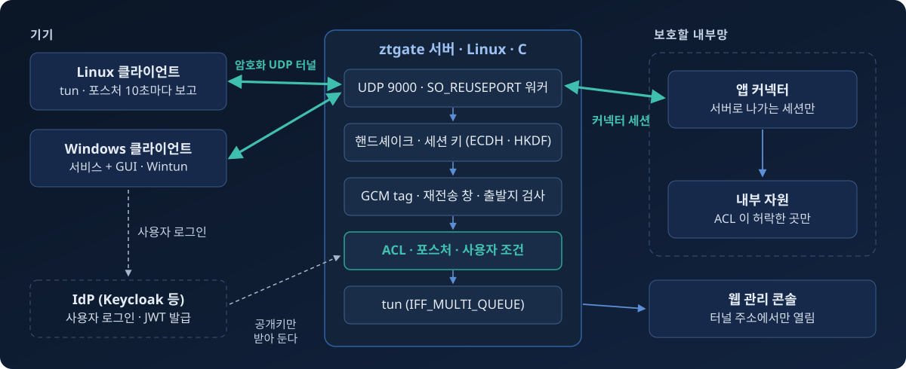

# ztgate 한눈에

ztgate 는 회사 네트워크로 들어오는 길을 기기마다 열고 닫는 VPN 입니다. 관리자가 등록한 기기만 서버에 붙습니다. 붙은 뒤에도 서버는 10초마다 PC 의 보안 상태를 다시 보고, 관리자가 ACL 에 적은 목적지로 가는 패킷만 내보냅니다.

## 구성 요소

ztgate 는 아래 조각으로 이루어집니다. 서버와 Windows 클라이언트만 있으면 쓸 수 있고, 나머지는 필요할 때 더합니다.

| 구성 요소 | 설치 위치 | 역할 |
|---|---|---|
| 서버 (`ztgate-server` 패키지) | Linux 서버 한 대, 장애에 대비하면 두 대 | 기기를 인증하고, 패킷마다 ACL 로 판정합니다. 기기 목록, ACL, 서버 키를 갖습니다 |
| Windows 클라이언트 (`ztgate.msi`) | 사용자 PC | 서비스와 GUI 입니다. 서버에 등록하고 연결하며, 방화벽, 백신, BitLocker 상태를 서버에 보고합니다 |
| 앱 커넥터 (`ztgate-connector` 패키지) | 사내망 안의 Linux 장비 | 서버가 사내망 밖에 있을 때, 서버로 나가는 세션을 열어 사내망을 내어 줍니다 |
| 웹 관리 콘솔 (`ztgate-console`) | 서버 안, `127.0.0.1:9470` | 세션, 기기, 등록 코드, ACL, 감사 로그를 브라우저에서 보고 고칩니다 |
| `ztgate` 명령 | 서버 | 콘솔과 같은 정보를 터미널에 표로 보여 줍니다. `ztgate setup` 은 처음 설정을 맡습니다 |
| MCP 서버 | 서버, `/opt/ztgate-mcp` (선택) | AI 에이전트가 SSH 로 서버를 관리하고 새 버전을 배포합니다 |

## 기기가 들어오기까지

1. 관리자가 콘솔에서 등록 코드를 만들고, 초대 링크를 사용자에게 보냅니다.
2. 사용자가 링크를 누르면 PC 가 키 쌍을 스스로 만들고, 공개키만 서버에 보내 등록합니다. 서버의 기기 목록에는 공개키만 남습니다.
3. 연결할 때마다 서버와 PC 가 서로를 확인하고, 그 연결에서만 쓸 세션 키를 새로 만듭니다.
4. 연결된 동안 PC 는 10초마다 보안 상태(포스처)를 보고합니다. 조건에 못 미치면 서버가 세션을 끊고, 사용자가 고치면 PC 가 저절로 다시 붙습니다.
5. 서버는 ACL 이 허용한 목적지로 가는 패킷만 내보냅니다. 맞는 규칙이 없으면 거부합니다.

## 안내서의 구성

| 독자 | 장 |
|---|---|
| Windows PC 사용자 | [Windows 에서 ztgate 로 회사 네트워크에 접속하기](user.md) |
| 서버 관리자 | [ztgate 서버 운영하기](admin.md)와 [ztgate 운영 참고](admin-reference.md) |
| 모든 독자 | [용어](glossary.md) |

프로토콜, 보안 모델, 모든 옵션은 [README](../../README.md)에 있습니다.
