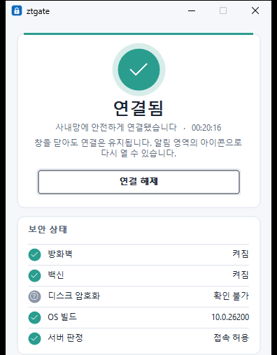

# Windows 에서 ztgate 로 회사 네트워크에 접속하기

이 안내서는 Windows PC 에서 회사 네트워크에 접속하는 순서를 적습니다. 인쇄해 읽으려면 서버 운영 안내와 함께 묶은 [PDF 안내서](ztgate-guide.pdf)를 씁니다.

## ztgate 설치하기

시작 메뉴에 **ztgate** 가 있으면 회사가 이미 설치한 것입니다. 없으면 IT 담당자에게 받은 `ztgate.msi` 를 실행합니다. 설치에는 관리자 권한이 필요합니다.

## 이 PC 를 처음 한 번 등록하기

회사가 설치할 때 등록 코드를 함께 넣었으면 이 단계는 필요 없습니다. ztgate 를 열면 "설치할 때 받은 등록 코드로 이 PC 를 등록하고 있습니다"가 보이고, 등록이 끝나면 연결할 수 있습니다. 서버가 그 코드를 받지 않았다는 안내가 보이면, 관리자에게 새 초대 링크나 코드를 받아 아래처럼 등록합니다.

관리자에게 초대 링크(`ztgate://enroll?...`)를 받았으면 그 링크를 누릅니다. 서버와 코드가 채워진 등록 창이 열리면 **서버에 등록**을 누릅니다.

등록 코드(`XXXXX-XXXXX-XXXXX-XXXXX-XXXXX`)를 받았으면 아래 순서로 등록합니다.

1. ztgate 를 열고 **설정**에 관리자가 알려 준 서버 이름과 포트를 적습니다. 회사가 정해 두었으면 이미 적혀 있습니다.
2. **기기 등록**을 누르고, 열린 창에 코드를 적은 뒤 **서버에 등록**을 누릅니다. 코드 대신 초대 링크를 붙여 넣어도 됩니다.

코드와 링크는 한 번만 쓸 수 있고, 관리자가 정한 유효 시간(기본 15분)이 지나면 만료됩니다. "서버가 이 코드를 받지 않습니다"가 나오면 관리자에게 새 코드를 받습니다.

## 연결하기

**연결**을 누릅니다. 창 위의 상태가 **연결됨**으로 바뀌면 회사 네트워크를 쓸 수 있습니다.

창을 닫아도 ztgate 는 시계 옆 알림 영역에 남아 연결을 유지합니다. 회사가 "늘 연결"로 정했으면 PC 를 켤 때 자동으로 연결됩니다. 이때 연결 단추에는 "회사 정책으로 늘 연결"이 보이고, 사용자가 연결을 끊을 수 없습니다.

회사가 사용자 로그인을 쓰면 **로그인** 단추가 보입니다. 단추를 누르면 브라우저가 열리고, 그 브라우저에서 회사 계정으로 로그인합니다. 회사 시스템 가운데 일부는 로그인한 사람에게만 열립니다.

## 화면의 안내에 따르기

| 화면의 안내 | 할 일 |
|---|---|
| Windows 방화벽이 꺼져 있습니다 | Windows 보안에서 방화벽을 켭니다. 켜면 자동으로 다시 연결됩니다 |
| 백신의 실시간 보호가 꺼져 있습니다 | 백신의 실시간 보호를 켭니다. 켜면 자동으로 다시 연결됩니다 |
| 시스템 드라이브의 BitLocker 가 꺼져 있습니다 | 회사 정책상 디스크 암호화가 필요합니다. 켜는 방법은 IT 담당자에게 묻습니다. 켜면 자동으로 다시 연결됩니다 |
| 이 PC 가 회사 보안 정책에 맞지 않습니다 | 방화벽, 백신, BitLocker 말고 다른 조건이 맞지 않습니다. IT 담당자에게 알립니다 |
| 서버에 이 기기가 없습니다 | 관리자에게 새 등록 코드를 받아 **다시 등록**으로 등록합니다 |
| 서버가 답하지 않습니다, 또는 다시 연결 중 | 인터넷에 연결돼 있는지 확인합니다. 인터넷이 되면 잠시 뒤 자동으로 다시 연결됩니다 |
| 이 네트워크는 로그인해야 인터넷을 쓸 수 있습니다 | 호텔이나 카페의 와이파이처럼 로그인 페이지가 있는 네트워크입니다. 안내를 누르면 로그인 페이지가 열리고, 로그인하면 자동으로 연결됩니다 |
| 서버가 이 프로그램보다 새 버전입니다 | ztgate 를 새 버전으로 업데이트해야 합니다. 회사가 자동 업데이트를 쓰면 ztgate 가 업데이트를 확인하는 중입니다. 계속 나오면 IT 담당자에게 알립니다 |
| 서버가 이 프로그램보다 오래된 버전입니다 | 서버를 새 버전으로 올려야 합니다. IT 담당자에게 알립니다 |

## 문제가 계속되면 기록 보내기

**진단** 창의 **패킷** 탭에서 **저장...** 을 눌러 패킷 목록을 CSV 파일로 저장하고, 그 파일을 IT 담당자에게 보냅니다. 파일에는 목록에 보이는 패킷마다 방향, 타입, 요약, 결과 같은 열이 들어 있습니다. 비밀번호와 키는 들어 있지 않습니다.
